# Jedi Knight & Mysteries of the Sith: Unused, orphaned and leftover content in the shipped game data

**Version 2.2** — November 2026

Have a new finding, a correction, or a file this document should look at again? Please [open an issue](https://github.com/Drumsin/jk-mots-unused-content/issues/new/choose) and tell us about it. Screenshots and exact file names help a lot. If you don't use GitHub, you can still post in Discord and it will be relayed here.

Research notes with file locations, quoted evidence, renders and source ratings. Game data: *Star Wars Jedi Knight: Dark Forces II* and *Mysteries of the Sith*, Steam releases.

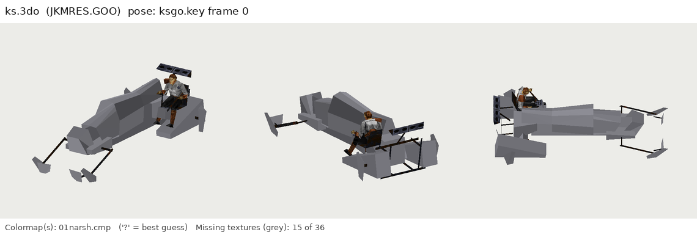

*ks.3do, the unused Kyle-on-speeder-bike model from MotS JKMRES.GOO, posed with its own ksgo.key animation. Grey parts use textures that never shipped.*

A print-ready PDF and a zip of this version will be added on the [Releases](https://github.com/Drumsin/jk-mots-unused-content/releases) page when v2.2 is published. The last published files are still [v2.1](https://github.com/Drumsin/jk-mots-unused-content/releases/tag/v2.1).

## Contents

- [About this document](#about-this-document)
- [A. The cut "Road to Baron's Hed" level (05) - leftovers in Mysteries of the Sith](#section-a)
  - [1. Tusken speeder bike: models, riders, debris and animations](#finding-1)
  - [2. The level-05 source folder and the 05v* animated ship models](#finding-2)
  - [3. A palette for the 05 sky textures](#finding-3)
  - [4. Other JK-era models that only ship with Mysteries of the Sith](#finding-4)
- [B. Traces of other cut or reworked JK levels](#section-b)
  - [5. The "13pipes" folder: props from the cut level 13](#finding-5)
  - [6. Unused level 13 textures](#finding-6)
  - [7. 16world, 16vale and 16spir](#finding-7)
  - [8. The "06fall" set pieces](#finding-8)
- [C. Unused dialogue](#section-c)
  - [9. Unused Qu Rahn lines about the Dark Jedi](#finding-9)
  - [10. Other unused JK voice clips](#finding-10)
  - [11. 01_trouble.cog: an unfinished Nar Shaddaa bar exchange](#finding-11)
  - [12. Unused MotS voices in the voiceuu folder](#finding-12)
- [D. Unused and orphaned scripts](#section-d)
  - [13. Kaerobani base: Mara quip triggers and other unused cogs](#finding-13)
  - [14. s2l1_murder.cog and other Nar Shaddaa scenes](#finding-14)
  - [15. Rahn on the escape ship, and a missing 17_rahnlines.cog](#finding-15)
  - [16. An early COG syntax](#finding-16)
  - [17. bddefault.ai: a "Baby Drugon"](#finding-17)
  - [18. Files that shipped scripts and models point to, but that do not exist](#finding-18)
  - [19. Dark Kyle in S6L1](#finding-19)
- [E. Weapons, animations and models](#section-e)
  - [20. repv / repp: the cut rifle, and its missing hand textures](#finding-20)
  - [21. Tusken prod view models](#finding-21)
  - [22. The 8t88 beast](#finding-22)
  - [23. Unused Kyle animations](#finding-23)
  - [24. Unreferenced alternate exports of models the games do use](#finding-24)
- [F. Headers, dates and development machines](#section-f)
  - [25. Level save dates](#finding-25)
  - [26. Internal project name and personal folders](#finding-26)
  - [27. Colormaps no level loads](#finding-27)
  - [28. Gaps in the MotS episode list](#finding-28)
- [G. Hints in comments](#section-g)
  - [29. Two level numberings in the JK episode and string files](#finding-29)
  - [30. Level 19A objectives that were rewritten](#finding-30)
  - [31. Commented-out control functions: Game Restore, Game Record and Debug](#finding-31)
  - [32. Officer and trooper voice lines that were listed but never shipped](#finding-32)
  - [33. "Cling Vines": a complete cut swamp creature in MotS](#finding-33)
  - [34. A purple stormtrooper variant (s5.3do)](#finding-34)
  - [35. Kill the Fool with the Ysalamiri: a bobbing animation and a deathmatch mode, switched off](#finding-35)
  - [36. MotS finale: disabled subtitles and a third model swap](#finding-36)
  - [37. S6L1 was built from the S1L1 scripts](#finding-37)
  - [38. The TIE bomber script says "level 04"](#finding-38)
  - [39. Script names in headers that differ from the shipped names](#finding-39)
  - [40. Source names inside model and animation headers](#finding-40)
  - [41. Change logs: dates, initials and an early start on MotS](#finding-41)
- [H. Added after community feedback](#section-h)
  - [42. 03trcr.3do: the little tractor from the Katarn farm](#finding-42)
  - [43. Unused Katarn farm and house textures that only MotS ships](#finding-43)
- [I. Added in v2.2](#section-i)
  - [44. An unfinished saber throw in Jedi Knight](#finding-44)
  - [45. Warning Sense: an unused MotS Force power that never got an effect](#finding-45)
- [Appendix A. Unreferenced asset lists](#appendix-a)
- [Appendix B. Unused texture contact sheet](#appendix-b)
- [Appendix C. Caveats](#appendix-c)
- [Appendix D. How to extract these files yourself](#appendix-d)
- [Appendix E. Sources and credits](#appendix-e)
- [Appendix F. What the cross-game check changed](#appendix-f)
- [Appendix G. Change log](#appendix-g)

<a id="about-this-document"></a>
## About this document

This is a catalogue of files in the retail Jedi Knight (JK) and Mysteries of the Sith (MotS) data that the games never load, or that point at files which do not exist. Many of them are leftovers from cut levels, early tests and earlier versions of models and scripts. Each finding gives the exact location so anyone can open the file and check it.

### Method

All shipped archives were extracted and read: JK Episode\JK1.GOB, JK1CTF.GOB, JK1MP.GOB and Resource\Res1hi.gob, Res2.gob; MotS Episode\JKM.GOO, JKM_KFY.GOO, JKM_MP.GOO, JKM_SABER.GOO and Resource\JKMRES.GOO, plus cutscenes.goo (inside Resource\VIDEO\CUTSCENES.ZIP) and the hidden S6L1 level (inside Resource\VIDEO\UNSUPPORTED.ZIP).

Community modder Shimstock pointed out that the MotS cutscenes were built as in-engine levels, played in the game, and recorded to video. Those earlier, unfinished scene setups are the JKL files in Resource\VIDEO\CUTSCENES.ZIP, already used as a source in this catalogue. The shipped episode does not load them; after each level it plays the later SMUSH videos (.san). (JK's live-action cutscenes are the .smk files.) The JKL worlds were last saved in late November 1997 through 2 January 1998, before the shipped MotS levels, and they still show unfinished names, disabled subtitles, leftover debug prints, and voice lines and props (including Ka'Pa the Hutt and Abron Mar) that never appear in a normal playthrough.

A reference graph was built for every file type. The roots are every level (.jkl), episode.jk, static.jkl, items.dat, models.dat, sabers.dat, the .per and .uni files and the file names hard-coded in the engine (taken from the OpenJKDF2 source, including the HUD icon naming rule and, since the revision after community modder KnightCop's feedback, the AI difficulty rule: *name*.ai0 on Easy and *name*.ai2 on Hard). From the roots, references were followed through templates, cogs, 3DOs, keyframes, puppets, sound sets, materials and colormaps. Comment lines were not counted as references, because a commented-out line loads nothing; the comments themselves were read separately (see the section "Hints in comments"). A file that no root reaches is "unreferenced". A name that is referenced but not present in any archive is a "missing reference".

3DO and KEY headers (source paths, exporter versions) and JKL headers (save dates, dev paths) were read for every file. Unused voice clips were transcribed automatically. 3DO renders in this document come from a small software renderer that follows the engine's hierarchy and matrix conventions. Textures are drawn with a colormap a level actually uses with them where one exists; otherwise the colormap is a best guess and is marked with "?".

### Cross-game check

Every item in this document was checked against *both* games, not only the game that ships it. MotS reuses a lot of JK data and JK files turn up in MotS, so a file that one game never loads can still be used by the other. For each asset the full text of both games was searched: every single-player, multiplayer, CTF and Kill-the-Fool level, the MotS cutscene levels and S6L1, static.jkl, items.dat, models.dat, sabers.dat, every template parameter (model3d, puppet, soundclass, cog, explode, fleshhit, creatething, material), every cog symbol and string, and every .3do/.key/.pup/.snd/.par/.spr file. Matches were made case-insensitively, with the full file name, the name without extension and plain substrings, and comment-only mentions were kept apart. Engine-loaded names were taken from the OpenJKDF2 source; the original game executables were not available for this survey.

Files were also compared by content: byte-identical copies under other names, identical 3DO geometry, and 3DOs that share most of their textures with a model the games do use. An asset is called unused only when nothing in either game loads it. Files that are alternate exports of in-game models are labelled as such. The per-asset results are in [cross_game_verification.csv](references/cross_game_verification.csv), and Appendix F lists what this check changed.

### Ratings

Each finding was checked against public community sources. **Known**: already documented. **Partly known**: some of it is documented, the rest (usually the file evidence) was not found. **Likely new**: no earlier source was found. "Likely new" is not a claim that nobody has seen it before; corrections are welcome.

### Credits

Community modder KnightCop's "Road to Barons Hed - Cut Mission Information" is the reference for the cut speeder-bike level and the bike assets. Other sources: The Cutting Room Floor, the Massassi Temple, r/jediknight, The Sounds Resource and the OpenJKDF2 project (engine file names and conventions). Full list in Appendix E.

### Locating files

Paths are given as *game - archive - internal path*. Archive paths are relative to the game's install folder. Internal names in GOB/GOO archives are case-insensitive and are shown in lower case. Any GOB/GOO extractor will open them (see Appendix D).

<a id="section-a"></a>
## A. The cut "Road to Baron's Hed" level (05) - leftovers in Mysteries of the Sith

<a id="finding-1"></a>
### 1. Tusken speeder bike: models, riders, debris and animations

**Rating:** Known

| Game | Archive | Internal path / files |
|---|---|---|
| MotS | Resource\JKMRES.GOO | 3do\tspd.3do, tspdup.3do, tspov.3do, tsbk_1.3do ... tsbk_8.3do |
| MotS | Resource\JKMRES.GOO | 3do\ts.3do (Tusken rider), 3do\ks.3do (Kyle rider) |
| MotS | Resource\JKMRES.GOO | 3do\key\ts{back,down,go,parked,start,turnl,turnr,up}.key, ks*.key (same set), tspov.key |
| JK + MotS | Resource\Res2.gob; Resource\JKMRES.GOO | 3do\mat\ts-blk.mat, ts-mtl.mat (the only two ts-*.mat that shipped; other models also use them) |

None of these files is referenced by any shipped level, template, cog or data file in either game. They are the complete vehicle set for the speeder-bike chase that was cut from Jedi Knight (the "05" slot between level 4, the escape from Kyle's family house, and level 6, Baron's Hed).

tspd.3do is the bike itself, tspdup.3do is an upright/parked variant, tspov.3do is the first-person cockpit view (its single mesh is named `huh01`) and tsbk_1 to tsbk_8 are the break-apart debris pieces. ts.3do and ks.3do are the bike with a full humanoid skeleton riding it: a Tusken (tk* textures) and Kyle (ky* textures). Both share a 20-node hierarchy (`$$$dummy, ts-a01, engine, head, hips, l4arm, larm, lcalf, lfoot, lhand, lleg, neck, r4arm, rarm, rcalf, rfoot, rhand, rleg, torso`), and each has its own set of eight keyframes (start, go, turn left/right, up, down, back, parked).

The bike references 17 ts-*.mat textures. Only ts-blk.mat and ts-mtl.mat exist (in both games, where other models also use them). The other 15 never shipped in either game, so the bike renders below are untextured (grey) apart from those two and the rider textures.

The riders are shown posed with frame 0 of ksgo.key / tsgo.key, which seats them on the bike.

**Evidence**

```
tspd.3do:  # MODEL 'TSPD.3do' created from 'D:\Jedi\Products\JK\Data\3DO\Ships\TuskenBike\TSPD.prj in VISUAL mode with ver4.63.'
tspov.3do: # MODEL 'Tspov.3do' created from 'D:\Jedi\Products\JK\Data\3DO\Ships\TuskenBike\POV\Tspov.prj in VISUAL mode with ver4.60.'
tsbk_1.3do: ... '\Ships\TuskenBike\debris\Tsbk_1.3do in VISUAL mode with ver4.50.'
ksgo.key:  # KEYFRAME '<unnamed>' created from 'KSGO.PRJ in BATCH mode with ver4.50.'  FRAMES 67  FPS 15  JOINTS 20
```

**Sources**

- Community modder KnightCop, "Road to Barons Hed - Cut Mission Information" (PDF, 2026) - documents the bike set and recreates the missing ts-* textures.
- Reddit r/jediknight, thread 1vnxazh (Aug 2026)
- TCRF states that no bike model exists; that is true of the JK archives only.

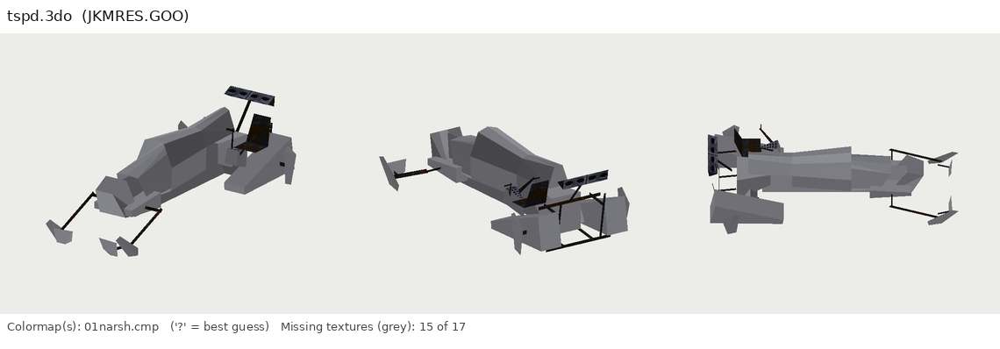

*tspd.3do, three angles (missing ts-* textures shown grey)*

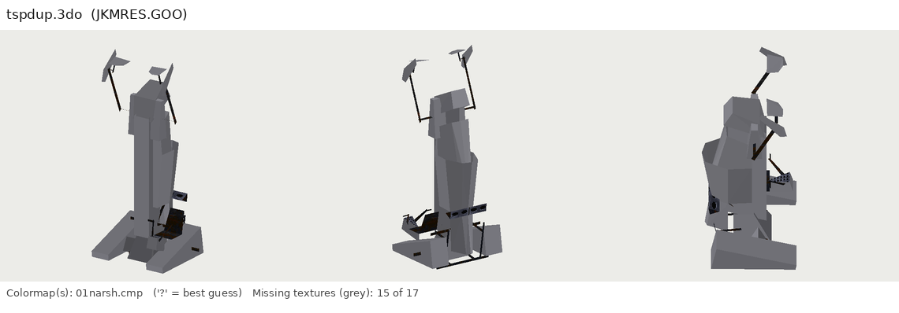

*tspdup.3do*

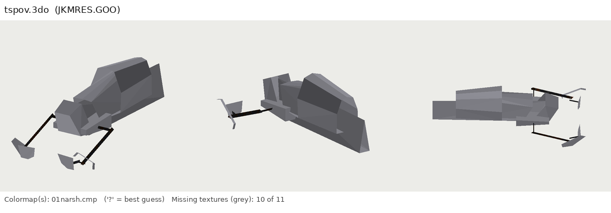

*tspov.3do, the first-person cockpit model*

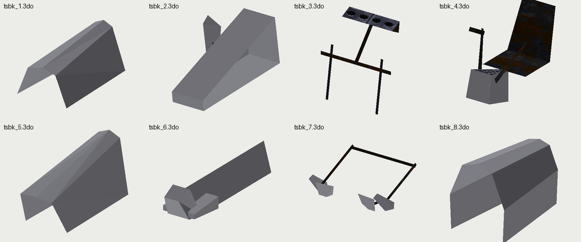

*tsbk_1 to tsbk_8 debris pieces*

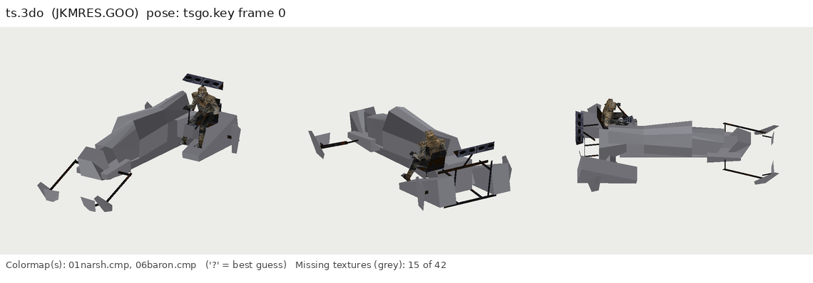

*ts.3do, Tusken rider, posed with tsgo.key frame 0*


*ks.3do, Kyle rider, posed with ksgo.key frame 0*

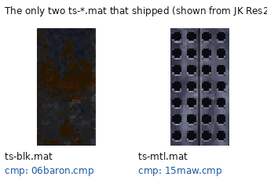

*The two shipped bike textures*

<a id="finding-2"></a>
### 2. The level-05 source folder and the 05v* animated ship models

**Rating:** Partly known

| Game | Archive | Internal path / files |
|---|---|---|
| MotS | Resource\JKMRES.GOO | 3do\05road.3do, 05road2.3do, 05road3.3do, roadblk.3do, roadsign.3do |
| MotS | Resource\JKMRES.GOO | 3do\05vcrowm.3do, 05vtiebm.3do, 05vtrnwg.3do; 3do\key\05vcrowa.key, 05vtieb.key, 05vtrnwg.key |

The 3DO headers record the original folder on the developer machine. Five road pieces come from a dedicated `LevelSpecific\05stuff\` folder: three road sections, a road block and a road sign. They are the track furniture for the bike chase. No file in either game references them.

Three "05v" models come from the ship animation folders, each with a matching keyframe. They are not new ships: each is an animation-ready export of a ship that both games use. These particular files and keys are referenced nowhere in either game (all levels, cutscene levels, templates, cogs and data files were searched).

**05vcrowm** is the Moldy Crow. It uses exactly the texture set of crow.3do (fewer vertices), which JK places in 02, 04, 08, 09, 12, 16a/16b and 17b and MotS uses in multiplayer map mdm12_spaceport. **05vtiebm** is the TIE bomber: same textures and same vertex count as tieb.3do, which appears in JK levels 01narshadda, 06bbarons and 08escape88 and in MotS s1l1_rebelbase. So the TIE bomber and the Crow are seen in game, but through tieb.3do and crow.3do, not through these 05v files.

**05vtrnwg** is the Imperial transport with WeeGee riding on it. Its node list is the transport (T~TRANSP) plus a droid body (BODY01, HEAD01, EYE, NECK, SHLDR, arm segments), and it uses the TTRN* transport textures together with WeeGee's textures (wg.3do, used in JK levels 03 and 04). The transport on its own (ttrn.3do) sits in the shed at the end of JK level 4 (04escapehouse.jkl) and is reused by MotS (s1l2, s1l4, s2l2a/b, s2l4 and a cutscene). Community modder KnightCop identifies the shed transport and lists the key as "WeeGee with Transport".

Community modder Shimstock pointed out that the leftover level-05 ship animations belong together. The Moldy Crow and TIE bomber keys (`05vcrowa.key` and `05vtieb.key`) have the same 371-frame length, share a dummy path of 70 JK units, and were both exported from the Crow animation folder. The two ships weave around that path; it is a sky dogfight, not two separate fly-bys. The written frame rates differ (21.5 fps for the Crow, 5 fps for the TIE), so the files as shipped would not finish together, and no cog remains to start them. The Imperial transport key (`05vtrnwg.key`) is a shorter, separate animation whose dummy node traces a turning path, which fits a transport flying a route through the cut level rather than fighting.

roadblk.mat and roadsign.mat are missing, so those pieces render partly grey. The other road textures are shown with JK 04farm.cmp (see the next finding); that colormap is a best guess.

**Evidence**

```
05road.3do:   ... 'D:\Jedi\Products\JK\Data\3DO\LevelSpecific\05stuff\05road.prj in VISUAL mode with ver4.50.'
roadblk.3do:  # MODEL 'Roadblk2.3do' created from '...\LevelSpecific\05stuff\Roadblk.prj ... ver4.00.'
05vcrowm.3do: ... 'D:\Jedi\Products\JK\Data\3DO\Ships\Crow\anims\05vcrowm.prj ... ver4.60.'   nodes: $$$DUMMY crow
05vtiebm.3do: nodes: $$$DUMMY tie~bmb   (tieb.3do: '...\Ships\TieBomber\TieB.3do')
05vtrnwg.3do: # MODEL '05Vtrnwg.3do' created from '...\Ships\TroopTransport\Anims\05Vtrnwg.prj ... ver4.60.'
05vtrnwg.3do: nodes: $$$DUMMY ARM~1 BODY01 EYE HEAD01 L~ARM01..04 NECK SHLDR SHLDR01 T~TRANSP arm~2..6
04escapehouse.jkl (JK1.GOB): model3d=ttrn.3do
```

**Sources**

- Community modder KnightCop, "Road to Barons Hed - Cut Mission Information" (PDF, 2026) lists the 05v* keyframes and identifies the level-4 shed transport. The 05stuff folder evidence and the model-by-model comparison were not found in it.
- Community modder Shimstock identified the Crow and TIE keys as a paired sky dogfight, and the transport key as a path through the level.

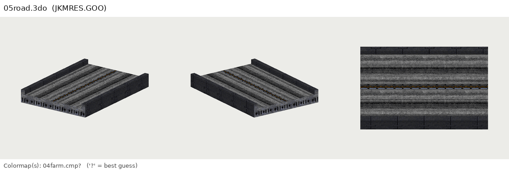

*05road.3do (colormap: JK 04farm, best guess)*

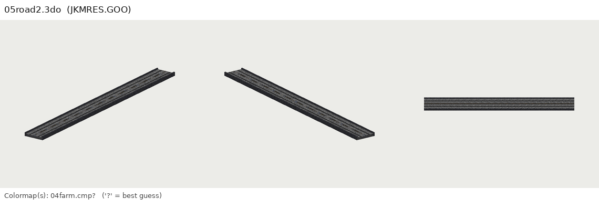

*05road2.3do*

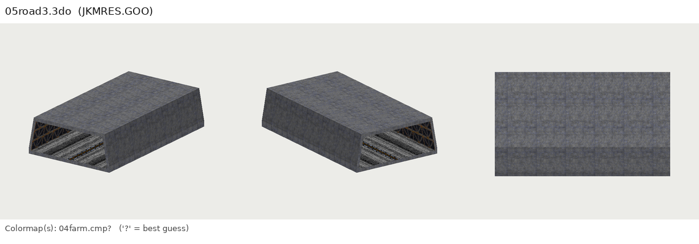

*05road3.3do*

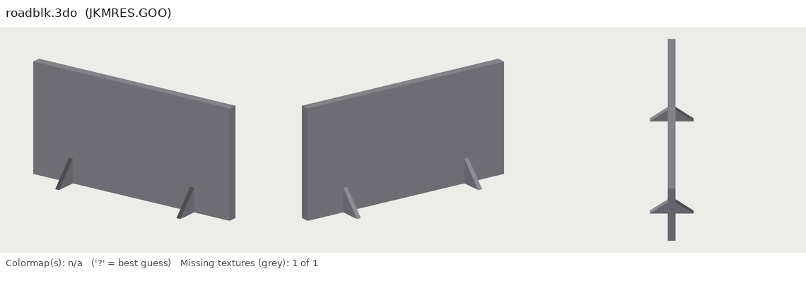

*roadblk.3do (texture missing)*

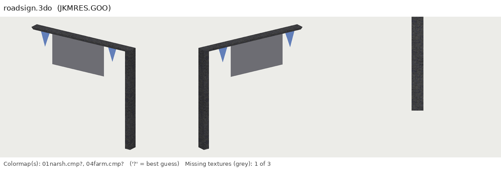

*roadsign.3do*

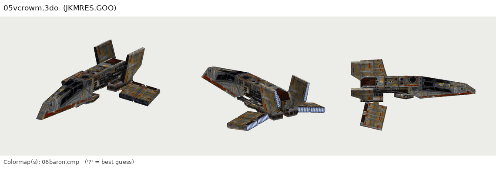

*05vcrowm.3do: Moldy Crow, animation export (the in-game Crow is crow.3do)*

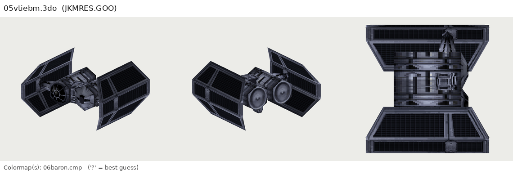

*05vtiebm.3do: TIE bomber, animation export (the in-game bomber is tieb.3do)*

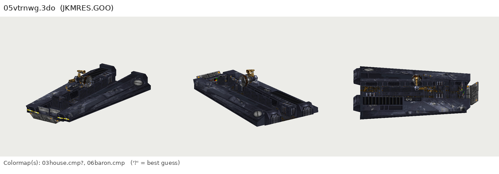

*05vtrnwg.3do: the Imperial transport with WeeGee riding it*

<a id="finding-3"></a>
### 3. A palette for the 05 sky textures

**Rating:** Likely new

| Game | Archive | Internal path / files |
|---|---|---|
| MotS | Resource\JKMRES.GOO | mat\05wsky01.mat, mat\05wsky02.mat |
| JK | Resource\Res2.gob | misc\cmp\04farm.cmp |

05wsky01/02 are 8-bit textures, so they need a colormap, and no level loads them. Community modder KnightCop's document lists them as "NO CMP". Shown through JK's 04farm.cmp (the colormap of level 4, the escape from Kyle's family house, the level just before the cut 05 slot), they come out as a clean blue sky with white clouds. 10cargo.cmp gives a similar result. The other 05 textures (road, walls, grass) also look natural under 04farm.cmp.

Period screenshots of the level support this. The magazine shots collected in KnightCop's document (PC Games, April 1997; Computer and Videogames, August 1997; PC Zone issue 51, June 1997) show the bike chase under a blue daytime sky with white clouds, which is what these two textures look like under 04farm.cmp.

This is still a visual match, not proof. It does suggest that level 05 shared a palette, and a time of day, with level 4.

**Evidence**

```
Community modder KnightCop PDF: "05wsky01.mat - NO CMP - Droid Works Version heavily dithered"
```

**Sources**

- Community modder KnightCop, "Road to Barons Hed - Cut Mission Information" (PDF, 2026) (magazine screenshots, pp. 14-17).
- No earlier source found pairing these textures with a colormap.

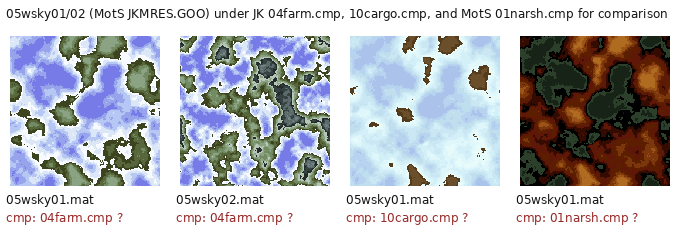

*05wsky01/02 under JK 04farm.cmp and 10cargo.cmp, with MotS 01narsh.cmp for comparison*

<a id="finding-4"></a>
### 4. Other JK-era models that only ship with Mysteries of the Sith

**Rating:** Partly known

| Game | Archive | Internal path / files |
|---|---|---|
| MotS | Resource\JKMRES.GOO | 3do\04vatrn.3do (+ key\04vatrn.key), atrn01.3do, blimp1.3do, blimp2.3do, sdes.3do, sch1.3do, oldja.3do, tree.3do, wwhl.3do |
| MotS | Resource\JKMRES.GOO | alternate copies of used models: shutdunc.3do, u2.3do, ug.3do, kelbite.3do, walt.3do |

About 130 3DOs in JKMRES.GOO carry `D:\Jedi\Products\JK\...` source paths, meaning they were built for Jedi Knight. Each one listed here was checked against every level, cutscene level, template, cog and data file in *both* games.

**Unused in both games, with no in-game equivalent:** 04vatrn, an AT-ST transport carrying an AT-ST (the node list is a full AT-ST rig plus "trans" and four doors; it has its own keyframe), atrn01 (ATSTtransport folder), two blimps (Ships\Blimps), a Star Destroyer (sdes, all 14 sdes* textures missing), sch1 (Ships\Schsr), an early Jan Ors (oldja, exported with the very old ver2.24 tool), a tree and a wooden wheel. The AT-ST itself (at.3do) is used in both games.

**Not really unused content:** several MotS-only files are alternate copies of models that the games do use. u2 and ug have the same geometry as u2alt.3do and ugalt.3do (Ugnaughts used in JK 09fuelstation and 16a/16b and in MotS s2l1, s2l2a/b and S6L1), just with older texture names that never shipped. shutdunc has the same texture set and vertex count as shut.3do, the Lambda shuttle used in both games. kelbite is a copy of JK's Kell dragon kd.3do (used in JK 08escape88 and 19b). walt is a variant of JK walt_b.3do (06bbarons).

The full list, with source paths and cross-game verdicts, is in [mots_unreferenced_assets.csv](references/mots_unreferenced_assets.csv) and [cross_game_verification.csv](references/cross_game_verification.csv).

**Evidence**

```
04vatrn.3do: # MODEL '04Vatrn.3do' created from 'D:\Jedi\Products\JK\Data\3DO\Ships\ATSTtransport\04Vatrn.prj ... ver4.61.'
04vatrn.3do: nodes: ATST-Base ATST-FootL ... ATST-Pelvs GunChin door01 door02 door03 door04 trans
oldja.3do:   # MODEL 'JA.3do' created from 'D:\Jedi\Products\JK\Data\3DO\SimChars\Jan\Ja.prj in VISUAL mode with ver2.24.'
kelbite.3do: # MODEL 'kd.3do' created from 'D:\Jedi\Products\JK\Data\3DO\SimChars\KellDragon\kd.3do ... ver4.63.'
u2.3do:      same geometry as u2alt.3do (used); ug.3do: same geometry as ugalt.3do (used)
```

**Sources**

- Massassi Temple (massassi.net) file and 3DO pages (a retextured Star Destroyer "from the MotS CD"). No single list of the rest was found.

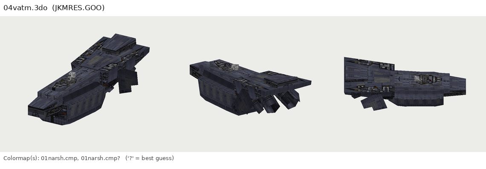

*04vatrn.3do: AT-ST transport with AT-ST (unused in both games)*

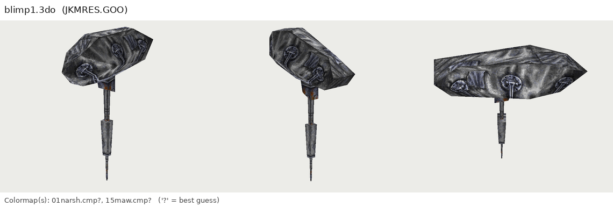

*blimp1.3do (unused in both games)*

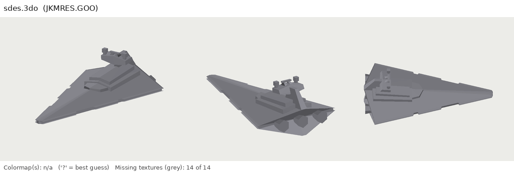

*sdes.3do (unused in both games; all textures missing)*

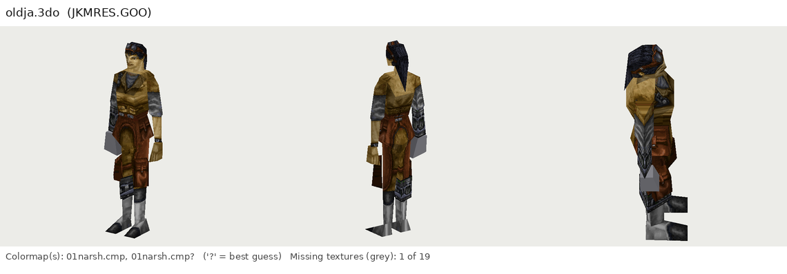

*oldja.3do, early Jan Ors (unused in both games)*

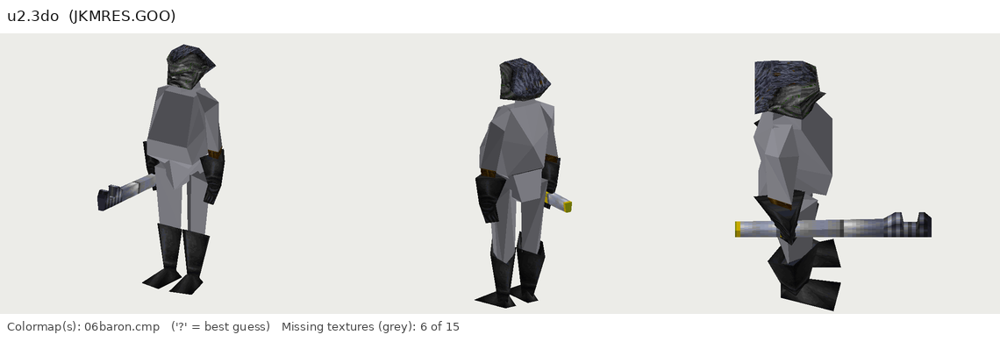

*u2.3do: same geometry as the used u2alt.3do; body textures missing*

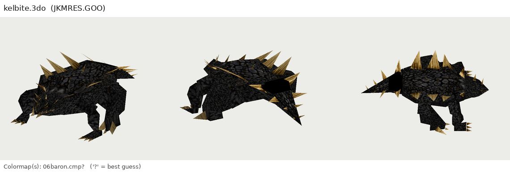

*kelbite.3do: a copy of JK's Kell dragon kd.3do*

<a id="section-b"></a>
## B. Traces of other cut or reworked JK levels

<a id="finding-5"></a>
### 5. The "13pipes" folder: props from the cut level 13

**Rating:** Likely new

| Game | Archive | Internal path / files |
|---|---|---|
| MotS | Resource\JKMRES.GOO | 3do\13rock.3do, 3do\zpip.3do, 3do\wct3x4.3do |
| MotS | Resource\JKMRES.GOO | mat\13wcanw7.mat; 3do\mat\zpip4.mat, zpip7.mat, zpip8.mat |

Three models come from a source folder named `LevelSpecific\13pipes\`: a canyon rock (13rock, textured with the 13wcanw7 canyon wall, a texture MotS later reused in s1l1_rebelbase), a pipe section (zpip, using zpip4/7/8) and wct3x4 (its two textures are missing). None of the three models is referenced by any file in either game, and no level-13 JKL ships in either game.

The textures suggest a canyon setting: 13rock is a canyon-wall rock, and zpip is a pipe section. Together with the unused 13* textures in the next finding and the gap at slot 13 in the episode numbering (see the comments finding on the two level numberings), these are the file leftovers of a cut level 13. They are the only known 3D leftovers of that slot.

**Evidence**

```
13rock.3do: ... 'D:\Jedi\Products\JK\Data\3DO\LevelSpecific\13pipes\13rock.prj in VISUAL mode with ver4.50.'
zpip.3do:   ... '...\LevelSpecific\13pipes\Zpip.3do in VISUAL mode with ver4.11.'
wct3x4.3do: ... '...\LevelSpecific\13pipes\wct3x4\Wct3x4.prj in VISUAL mode with ver4.60.'
```

**Sources**

- No earlier source found.

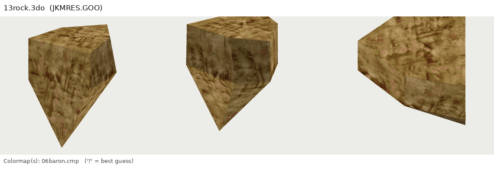

*13rock.3do*

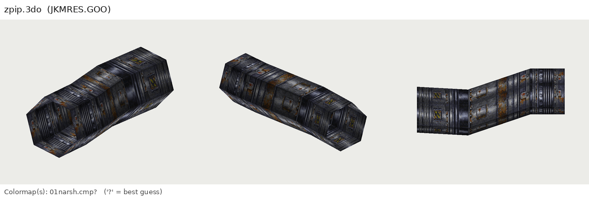

*zpip.3do*

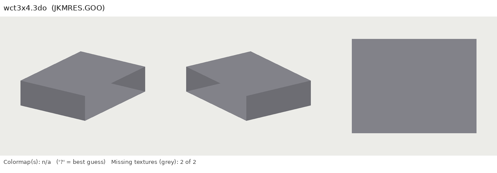

*wct3x4.3do (textures missing)*

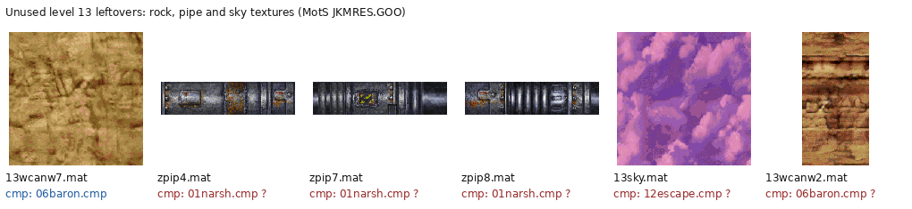

*Unused level 13 textures: 13wcanw7 (13rock; MotS also reuses it in s1l1_rebelbase), zpip4/7/8 (zpip), 13sky (shown with JK 12escape.cmp, best guess) and a canyon wall*

<a id="finding-6"></a>
### 6. Unused level 13 textures

**Rating:** Partly known

| Game | Archive | Internal path / files |
|---|---|---|
| MotS | Resource\JKMRES.GOO | mat\13wcanw1-6.mat, 13sky*.mat, 13fwat*.mat, 13wdrok*.mat, 13car*.mat, 13cnsky1/3.mat (41 files) |
| JK | Resource\Res2.gob | mat\13frokg2.mat, mat\13wconc1.mat |

MotS ships 43 textures with the 13 prefix that no MotS level loads. Checked against JK as well, 41 of them are unused in both games: canyon walls, skies, water, rock and a car/vehicle texture. The textures suggest a canyon setting. JK itself ships two more unused 13* textures (13frokg2, also copied into MotS, and 13wconc1). A selection is on the texture contact sheet in Appendix B.

Two are not unused: **13wcanw7** is used by MotS level s1l1_rebelbase, and MotS's copy of **13fwater** is byte-identical to the JK texture used in 04escapehouse, 06bbarons and 17asarris.

The 13sky* textures are shown with JK 12escape.cmp, the colormap of the preceding level 12 (12escape). That is a best guess.

The 13cnsky set is different: it is a grey storm sky, and 13cnsky2 is used by shipped levels (15maw, 17asarris, 17bsarris, 18ascend and some multiplayer maps). Only 13cnsky1 and 13cnsky3 are unused, so this set should not be read as the cut level 13 sky.

**Evidence**

```
13wcanw7.mat: referenced by mots_JKM.GOO\jkl\s1l1_rebelbase.jkl
13fwater.mat: referenced by jk_JK1.GOB\jkl\04escapehouse.jkl, 06bbarons.jkl, 17asarris.jkl
See cross_game_verification.csv (rows starting with 13).
```

**Sources**

- Covered in part by existing community texture exports.

<a id="finding-7"></a>
### 7. 16world, 16vale and 16spir

**Rating:** Likely new (purpose speculative)

| Game | Archive | Internal path / files |
|---|---|---|
| MotS | Resource\JKMRES.GOO | 3do\16world.3do, 16vale.3do, 16spir.3do; 3do\mat\16world.mat, 16spir2b.mat, 16spir3b.mat |

Three simple models exported in batch mode with an early tool version (ver4.11). 16world is an open cylinder whose texture shows a distant valley with a tower on the horizon; 16vale and 16spir are tall rock-like pieces. None is referenced. A distant backdrop for the falling-ship levels is one possibility, but nothing in the data confirms the purpose.

The first published render of 16world used a guessed MotS colormap (`10cargo.cmp`) and looked pale enough to be read as snowy mountains. Those colors are not a fact about the texture: the model's own colormap was not found. With a complete JK colormap (`04farm.cmp`) the same texture is a blue sky with brown clouds over a dark valley and a tower, with no snow. The colors should be treated as uncertain. This colormap concern was raised in a review of this catalogue.

**Evidence**

```
16world.3do: # MODEL '16world.prj' created from '16world.prj in BATCH mode with ver4.11.'
16spir.3do:  # MODEL '16spir.prj' created from '16spir.prj in BATCH mode with ver4.11.'
```

**Sources**

- No earlier source found. The concern that the pale colors were a colormap guess, not snow, was raised in a review of this catalogue.

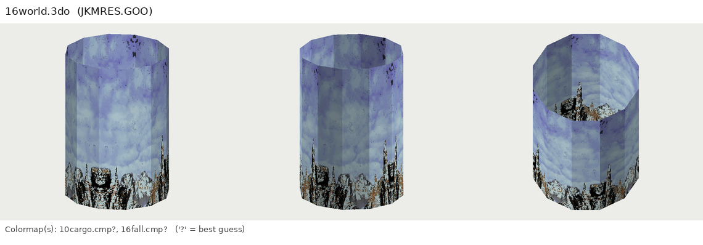

*16world.3do with the guessed MotS 10cargo.cmp used in the first published render (pale, easily read as snow)*

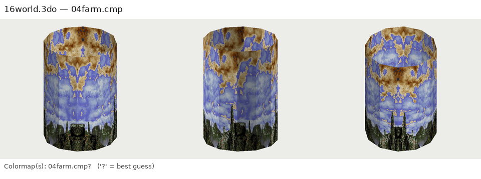

*16world.3do with JK 04farm.cmp: a blue sky, brown clouds, a dark valley and a tower; not snow*

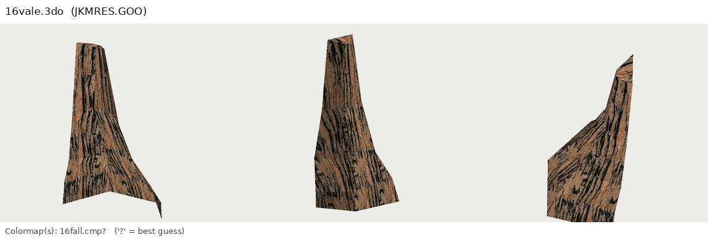

*16vale.3do*

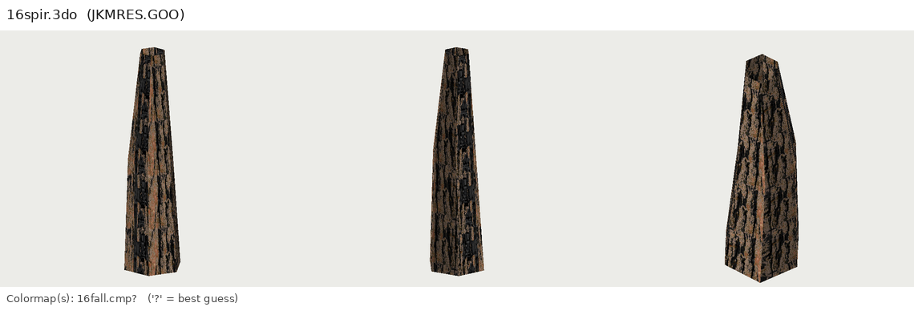

*16spir.3do*

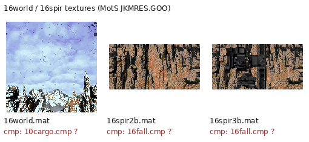

*16world / 16spir textures*

<a id="finding-8"></a>
### 8. The "06fall" set pieces

**Rating:** Likely new

| Game | Archive | Internal path / files |
|---|---|---|
| MotS | Resource\JKMRES.GOO | 3do\06buck.3do, 06struta.3do, 06strutb.3do; also 06rock1/2, 06mound, 06wl1-5, 06lock_z, 06lockab |

Models from a `LevelSpecific\06-3dos\06fall\` folder (level 6 is Baron's Hed). The names suggest a bucket and two struts for a falling or collapsing set piece. They ship only in MotS and no file in either game references them.

Related models are used: 06struta/06strutb share their textures with strut03/strut06, which MotS uses (s2l2a, s5l3, mdm12), and 06lock_z matches the textures of 06lock_x/06lock_y in JK 06bbarons. The 06fall pieces themselves never appear.

**Evidence**

```
06buck.3do:   ... 'D:\Jedi\Products\JK\Data\3DO\LevelSpecific\06-3dos\06fall\06buck.prj in VISUAL mode with ver4.11.'
06struta.3do: ... '...\06-3dos\06fall\06struta.prj in VISUAL mode with ver4.11.'
```

**Sources**

- No earlier source found.

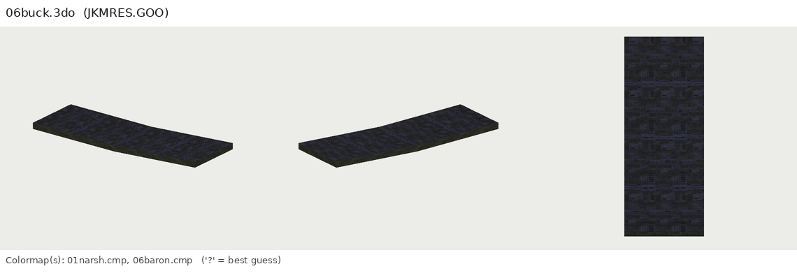

*06buck.3do*

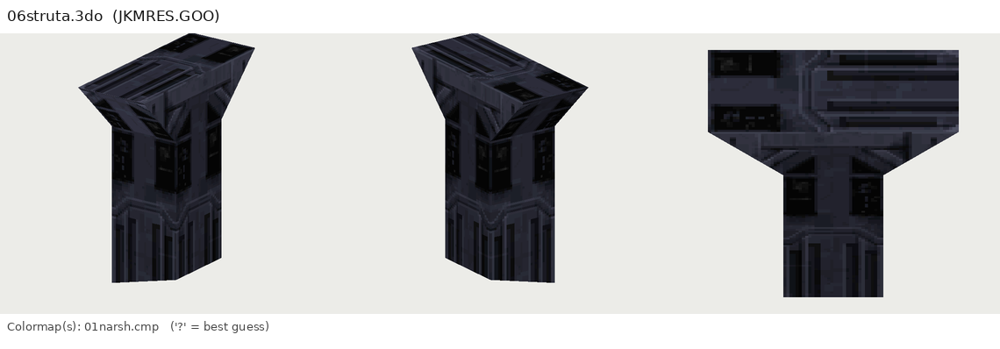

*06struta.3do*

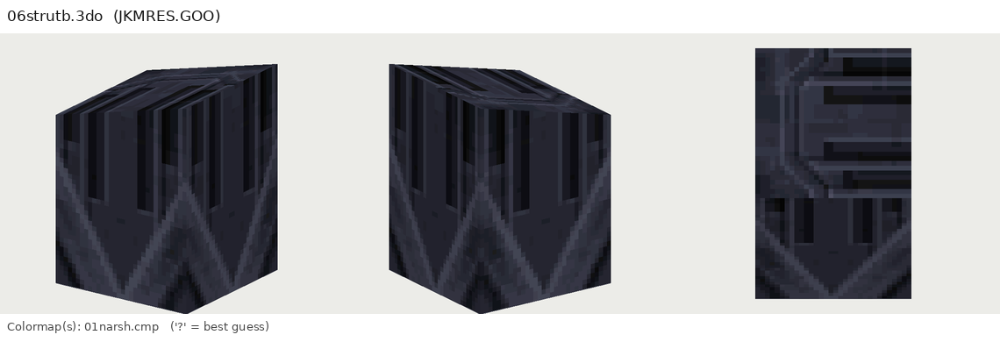

*06strutb.3do*

<a id="section-c"></a>
## C. Unused dialogue

<a id="finding-9"></a>
### 9. Unused Qu Rahn lines about the Dark Jedi

**Rating:** Partly known

| Game | Archive | Internal path / files |
|---|---|---|
| JK | Resource\Res1hi.gob | voice\i00ra20z.wav, voice\i00ra51z.wav, voice\i00ra52z.wav |

Qu Rahn's Dark Jedi descriptions are numbered in sequence. Three clips in the series are never played: i00ra20z sits between the used Yun lines 19 and 21, and i00ra51z/52z sit between Boc (49-50) and Jerec (53). They are extra descriptions of Yun and Boc.

Transcripts were made automatically and should be checked by ear.

**Evidence**

```
i00ra20z.wav: "This young man grew up knowing only the dark side and has never seen the light side and its power."
i00ra51z.wav: "He may look clumsy and uncoordinated, almost drunk at times, but I found that he is very able and can sustain an effective energy level that would leave most exhausted."
i00ra52z.wav: "If it isn't his manner that throws you, it would be his hyperactive skill."
```

**Sources**

- The Sounds Resource (sounds-resource.com) JK voice rips include the audio. No source was found that flags these lines as unused.

<a id="finding-10"></a>
### 10. Other unused JK voice clips

**Rating:** Likely new

| Game | Archive | Internal path / files |
|---|---|---|
| JK | Resource\Res1hi.gob | voice\i00ky28z.wav, i00ky47z.wav, i00ky71z.wav, i00wm02z.wav, i00wm03z.wav |

Kyle lines and two civilian (wm) lines that no cog or level plays.

i00ky71z is commented out as the drowning sound in every Kyle sound set (ky.snd and the multiplayer kymp*.snd sets: "#drowning i00ky71z.wav"). The line right above it plays i00ky71t.wav instead, so Kyle does make a drowning sound in the game; it is a different, longer recording (1.6 s against 0.65 s, and the waveforms do not match).

**Evidence**

```
i00ky28z.wav: "Big enough door."
i00ky47z.wav: "This must lead to the upper bulkhead."
i00ky71z.wav: (grunt)  -  ky.snd: drowning i00ky71t.wav (used) / #drowning i00ky71z.wav (commented out)
i00wm02z.wav: "Run!"
i00wm03z.wav: "No blasters, no blasters!"
```

**Sources**

- No earlier source found.

<a id="finding-11"></a>
### 11. 01_trouble.cog: an unfinished Nar Shaddaa bar exchange

**Rating:** Likely new

| Game | Archive | Internal path / files |
|---|---|---|
| JK | Episode\JK1.GOB | cog\01_trouble.cog |

An unused cog for a bartender exchange in level 1. The bartender's line (i00mn19z.wav) is real, but the three follow-up lines (snappycomeback, followup, riposte) are `xxx.wav` placeholders and the calls that would play them are commented out. The scene was set up and never recorded.

**Evidence**

```
sound        paying=i00mn19z.wav
sound        snappycomeback=xxx.wav
sound        followup=xxx.wav
sound        riposte=xxx.wav
//    PlaySoundLocal(snappycomeback, 1, 0.0, 0);
```

**Sources**

- No earlier source found.

<a id="finding-12"></a>
### 12. Unused MotS voices in the voiceuu folder

**Rating:** Likely new

| Game | Archive | Internal path / files |
|---|---|---|
| MotS | Resource\JKMRES.GOO | voiceuu\*.wav (46 files: 28 civilian, rebel and announcement clips; 15 Ka'Pa the Hutt lines; 3 Abron Mar lines) |

The folder `voiceuu` (uu = unused) in JKMRES.GOO holds 46 WAV files that a normal playthrough never loads. Community modder Shimstock pointed out this folder, and recalled that many of the clips were from the cutscenes.

28 of them are unreferenced civilian, rebel and announcement lines in the same numbering series as clips S6L1 does use (cm501xx, cm601xx, cw500xx, cw601xx, 2r6011x, cp641xx). An earlier version of this document counted 26 of that group. The civilians offer items ("Take this, it might help you" / "Don't tell anyone where you got this") or refuse ("Not after what you've done"), which suggests a civilian give-item and reaction system that was cut back. 2r6011x are rebel squad lines and cp641xx are station announcements.

The other 18 are lines for the leftover in-engine ending cutscenes in CUTSCENES.ZIP. Fifteen are Ka'Pa the Hutt speaking Huttese (`ka921*` from the S2L1 palace ending, and `ka924*` from the S2L4 ending). Three are Abron Mar (`ab92206`, `ab92207` and `ab92208`) from the S2L2 ending. Those leftover cutscene cogs still name the files, but the shipped episode plays SMUSH videos (`.san`) instead, so these WAVs never run in a normal MotS playthrough and exist only under voiceuu. The Ka'Pa clips were identified by listening; they are Huttese, not English, and are not quoted here. Abron Mar's three lines are spoken English in that leftover S2L2 ending, but they are described rather than quoted until they can be transcribed with confidence.

Mara's matching lines from the same cutscenes (`mj921*`, `mj924*`) are not in JKMRES. The MotS sound archive (JKMsndLO.goo) was checked for Kaerobani (`kb*`) voice files and none were found (see Finding 24). It has not been fully transcribed for duplicates of the voiceuu clips.

**Evidence**

```
cm50140.wav "Long live the rebellion!"   cm60145.wav "Long live the New Republic."
cm60143.wav "Take this, it might help you."   cm60144.wav "Don't tell anyone where you got this."
cm60154.wav "Not after what you've done."   cw60159.wav "Are you really a Jedi?"
2r60118-21.wav "Hey! Whose side are you on?" / "Traitor" (auto-transcribed as "Trader") / "Follow me!" / "Return fire!"
cp64114.wav "Warning, depressurization imminent."   cp64117.wav "Depressurization averted."
voiceuu holds 46 WAVs. Ka'Pa (Huttese, not quoted): ka92102, 04, 05, 07, 09, 12, 13, 14, 16, 17, 18, 20; ka92403, 06, 07. Abron Mar: ab92206, ab92207, ab92208 (English, not quoted here). Referenced only by leftover cutscene cogs s2l1_endcut.cog, s2l4_endcutscene.cog, s2l2b_endcutscene.cog.
```

**Sources**

- Community modder Shimstock pointed out the unused voiceuu folder in JKMRES, and that many of the clips came from the cutscenes. The Ka'Pa lines were identified by listening, in a review of this catalogue.

<a id="section-d"></a>
## D. Unused and orphaned scripts

<a id="finding-13"></a>
### 13. Kaerobani base: Mara quip triggers and other unused cogs

**Rating:** Likely new

| Game | Archive | Internal path / files |
|---|---|---|
| MotS | Episode\JKM.GOO | cog\s4l3_bad_feeling.cog, s4l3_didn't_i_just.cog, s4l3_get_a_ship.cog, s4l3_this_is_easy.cog, s4l3_how_to_pull.cog, s4l3_cant_believe.cog, s4l3_looks_like_trouble.cog, s4l3_better_way.cog (31 s4l3 cogs in total) |

31 cogs named for the Kaerobani base level are never loaded by it. Eight are trigger cogs for Mara one-liners; they print subtitle string IDs 10043, 10000 and 43003 (the strings themselves live in the MotS voice/string archive). Others cover safety tunnels, crate storage, the palace exit and a ship generator.

**Evidence**

```
# s4l3_badfeeling.cog
#
# Mara says a smart-ass line about lazy pirates.
#
# [RD]
```

**Sources**

- No earlier source found.

<a id="finding-14"></a>
### 14. s2l1_murder.cog and other Nar Shaddaa scenes

**Rating:** Likely new

| Game | Archive | Internal path / files |
|---|---|---|
| MotS | Episode\JKM.GOO | cog\s2l1_murder.cog, cog\s2l1_nicereeyee.cog, cog\s2l2_ballet.cog |

s2l1_murder.cog is an unused scripted scene: ReeYee threatens and shoots a Rodian (sound variables are commented "greedo freaking out" and "oh no! tragedy has struck!"). s2l1_nicereeyee.cog is a related pedestrian-attack trigger. s2l2_ballet.cog sets up three AI "dancers" on a patrol route.

**Evidence**

```
# S2L1_murder.cog
#
# Greedo shot and killed in his home by gangster!
#
# [TT]
```

**Sources**

- No earlier source found.

<a id="finding-15"></a>
### 15. Rahn on the escape ship, and a missing 17_rahnlines.cog

**Rating:** Likely new

| Game | Archive | Internal path / files |
|---|---|---|
| JK | Episode\JK1.GOB | cog\16a_rahn.cog |
| JK | Resource\Res2.gob | cog\darkjedi_sariss.cog |

16a_rahn.cog would play a Rahn line on a timer at the start of level 16, with "different files for light side and dark side"; it is unused. darkjedi_sariss.cog waits for a message from 17_rahnlines.cog, which does not ship; only 17a_rahnlines.cog exists.

**Evidence**

```
16a_rahn.cog:        # 16a_Rahn's line  /  # Plays Rahn's voice after timer at startup.
darkjedi_sariss.cog: // Receives message from 17_rahnlines.cog once game starts
```

**Sources**

- No earlier source found.

<a id="finding-16"></a>
### 16. An early COG syntax

**Rating:** Likely new (observation)

| Game | Archive | Internal path / files |
|---|---|---|
| JK | Episode\JK1.GOB | cog\vectortest.cog, wallceltest.cog, slidetest.cog, redlight.cog, simple_door.cog, togldoor.cog, rotate_plat.cog |
| JK | Resource\Res2.gob | cog\door_switch.cog, gen_move.cog |

These test and utility cogs declare symbols on numbered lines (`0: surface slideSurf 0`) and use `desc=`, unlike the shipped format. This looks like a pre-release COG syntax that survived in test scripts.

**Evidence**

```
vectortest.cog:
0:    surface        slideSurf    0
0:    flex        speed           0.1
0:    vector        vec        0
0:    int        animId        0    local
```

**Sources**

- No earlier source found.

<a id="finding-17"></a>
### 17. bddefault.ai: a "Baby Drugon"

**Rating:** Likely new

| Game | Archive | Internal path / files |
|---|---|---|
| JK | Resource\Res2.gob | misc\ai\bddefault.ai |

An AI file for a baby drugon. No model or template uses it; the shipped drugon uses dudefault.ai.

**Evidence**

```
# BDDEFAULT.AI
#
# Baby Drugon AI
# All difficulty levels
#
# [CR]
```

**Sources**

- No earlier source found.

<a id="finding-18"></a>
### 18. Files that shipped scripts and models point to, but that do not exist

**Rating:** Likely new / Partly known

| Game | Archive | Internal path / files |
|---|---|---|
| MotS | Resource\VIDEO\UNSUPPORTED.ZIP | S6L1 .jkl -> S6L1_lighttube2.cog (missing) |
| MotS | Resource\VIDEO\CUTSCENES.ZIP | cutscenes.goo episode.jk -> s5l2_ocs.jkl, finale.jkl (missing) |
| JK | Resource\Res2.gob | xtank*b.3do -> xtank2.mat; r2x1.3do -> railclr.mat; repv.3do -> ft-*.mat; shard0.3do -> 00_glass.mat |

Dangling references show what was renamed or dropped late. The hidden S6L1 level loads S6L1_lighttube2.cog, which is not in UNSUPPORTED.ZIP. The cutscene episode lists s5l2_ocs.jkl and finale.jkl, but the archive holds s5_ocs and s5_finale instead. MotS items.dat names item_supershields.cog and icwrenc*.bm. xtank2.mat and railclr.mat exist in neither game.

Checked across both games: JK's shard0.3do (used) asks for 00_glass.mat, which JK does not ship but MotS ships and uses. The repv.3do hand textures (ft-*) are likewise missing from JK but present, unused, in MotS.

The complete list is in [missing_references.csv](references/missing_references.csv).

**Evidence**

```
S6L1.jkl:  49:    S6L1_lighttube2.cog
S6L1.jkl:  7:    S6L1_lighttube2.cog    0 -1 activate01.wav
```

**Sources**

- No earlier source found for most entries.

<a id="finding-19"></a>
### 19. Dark Kyle in S6L1

**Rating:** Partly known

| Game | Archive | Internal path / files |
|---|---|---|
| MotS | Resource\VIDEO\UNSUPPORTED.ZIP | S6L1 .jkl (template darkkyle, kk.3do) |
| MotS | Resource\JKMRES.GOO | cog\61darkjedi_kyle.cog, 3do\kk.3do |

S6L1 defines a darkkyle template (kk.3do, 20,000 health) and JKMRES ships 61darkjedi_kyle.cog ("Mission's Dark Kyle" [YB]). The level never loads that cog; it only loads 61darkjedi_mara.cog. How Dark Kyle is driven in the level was not verified.

**Evidence**

```
61darkjedi_kyle.cog: # DARKJEDI_KYLE.COG
```

**Sources**

- A Steam community guide says Dark Kyle appears in the garbage room of S6L1.

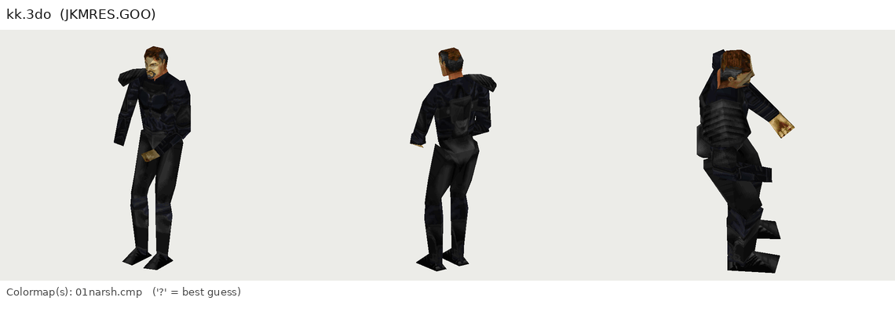

*kk.3do (Dark Kyle)*

<a id="section-e"></a>
## E. Weapons, animations and models

<a id="finding-20"></a>
### 20. repv / repp: the cut rifle, and its missing hand textures

**Rating:** Known (detail likely new)

| Game | Archive | Internal path / files |
|---|---|---|
| JK | Resource\Res2.gob | 3do\repv.3do (view model), 3do\repp.3do (pickup) |
| JK + MotS | Resource\Res2.gob; Resource\JKMRES.GOO | 3do\rep0.3do (early projectile; listed in static.jkl, unused) |

The cut rifle is documented. The new detail is in repv.3do's material list: seven hand textures (ft-wrt, ft-wrs, ft-tp, ft-thb, ft-fng, ft-wrb, ft-bt) that do not exist in JK, so the first-person model had a rendered fist and hand. Same-named ft-* textures exist in MotS JKMRES.GOO, and the render below uses those. The source path puts the model under RepeaterGun\View and it was exported with ver2.30, one of the oldest exporter versions in the data.

Community modder Shimstock noted that `rep0.3do` is the repeater's projectile and is still in the assets. It is an early export (`RepeaterGun\projectile0\Rep0.prj`, ver2.30) and is listed in both games' static.jkl, but no template uses it as `model3d=`. The shipped repeater fires `+repeaterball`, whose model is the later `rpt0.3do` (`RepeaterGun\projectile\`, ver4.63). The other old projectile0 models (Bryar, concussion, detonator, rail) are still the ones those weapons fire; only the repeater's earlier shot was left behind, in the same generation as the cut `repv` / `repp` rifle.

**Evidence**

```
repv.3do: # MODEL 'RepV.3do' created from 'D:\Jedi\Products\JK\Data\3DO\Weapons\RepeaterGun\View\Repv.prj in VISUAL mode with ver2.30.'
MATERIALS 13
  6:     FT-WRT.MAT   7: FT-WRS.MAT   8: FT-TP.MAT   9: FT-THB.MAT
  10:    FT-FNG.MAT  11: FT-WRB.MAT  12: FT-BT.MAT
rep0.3do: # MODEL 'Rep0.3do' created from '...\RepeaterGun\projectile0\Rep0.prj in VISUAL mode with ver2.30.'
static.jkl lists rep0.3do; no template has model3d=rep0.3do; +repeaterball uses model3d=rpt0.3do
```

**Sources**

- The Cutting Room Floor, "Star Wars Jedi Knight: Dark Forces II" page (read via an archived Wayback Machine copy, 2025).
- Community modder Shimstock noted that rep0.3do is the repeater's earlier projectile still in the assets.

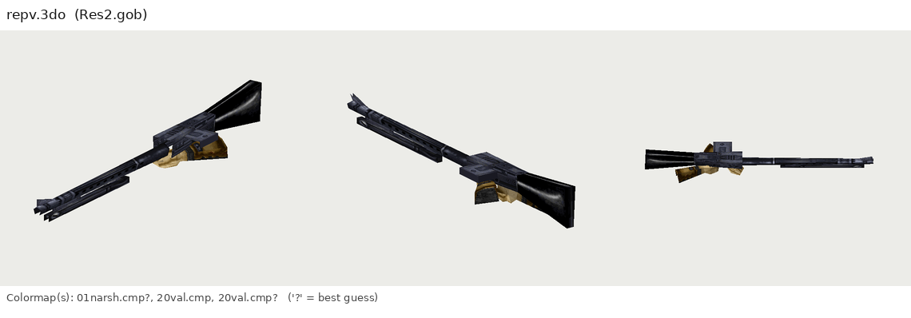

*repv.3do (hand textures taken from MotS)*

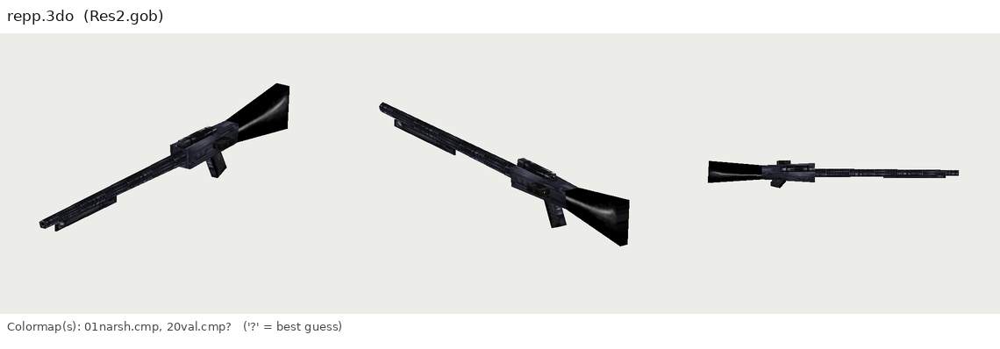

*repp.3do*

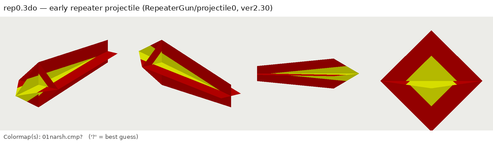

*rep0.3do, the unused early repeater projectile (colormap JK 01narsh, best guess)*

<a id="finding-21"></a>
### 21. Tusken prod view models

**Rating:** Known

| Game | Archive | Internal path / files |
|---|---|---|
| MotS | Resource\JKMRES.GOO | 3do\prdv.3do, prgv.3do, prdp.3do, prdg.3do (+ keys) |

Two first-person variants of the Tusken gaderffii weapon: a fork (ForkView) and a gun (GunView). Some of their textures are missing.

**Evidence**

```
prdv.3do: ... 'D:\Jedi\Products\JK\Data\3DO\Weapons\TuskenProd\ForkView\PrdV.prj ... ver4.20.'
prgv.3do: ... '...\Weapons\TuskenProd\GunView\PrgV.prj ... ver4.11.'
```

**Sources**

- Massassi Temple (massassi.net) file and 3DO pages ("Early Dev Enemy Pack").

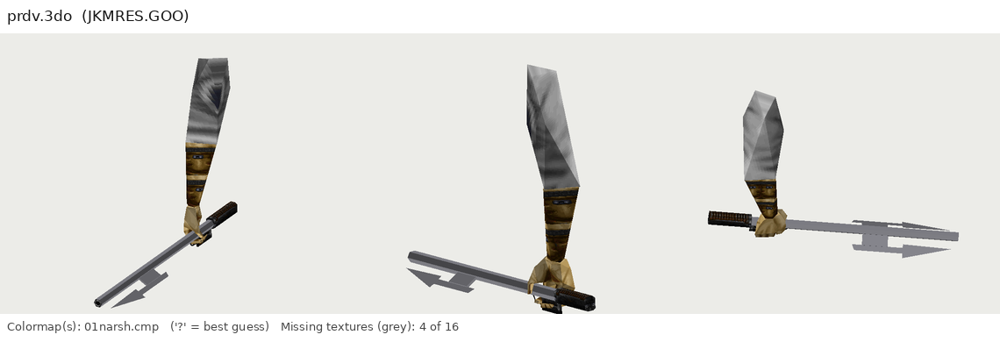

*prdv.3do (fork view)*

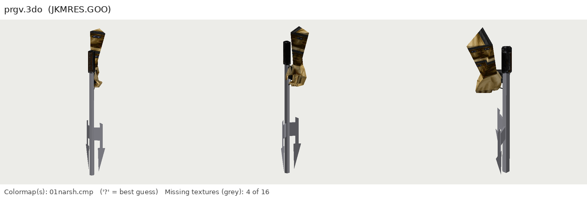

*prgv.3do (gun view)*

<a id="finding-22"></a>
### 22. The 8t88 beast

**Rating:** Known

| Game | Archive | Internal path / files |
|---|---|---|
| MotS | Resource\JKMRES.GOO | 3do\8b.3do; 3do\key\8b*.key (14 keyframes) |

A winged beast with 14 animations (run, bite, fly, jump attacks, death and more). The model is from a SimChars\Beast folder. It is shown posed with frame 0 of 8brun.key.

**Evidence**

```
8b.3do:    # MODEL 'bstblank.3do' created from 'D:\Jedi\Products\JK\Data\3DO\SimChars\Beast\Anims\bstblank.3do ... ver4.30.'
8brun.key: # KEYFRAME '<unnamed>' created from 'bstrun.l3d in BATCH mode with ver4.30.'
```

**Sources**

- Massassi Temple (massassi.net) file and 3DO pages.

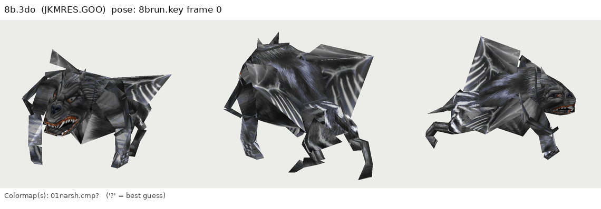

*8b.3do posed with 8brun.key frame 0*

<a id="finding-23"></a>
### 23. Unused Kyle animations

**Rating:** Known / Partly known

| Game | Archive | Internal path / files |
|---|---|---|
| JK | Resource\Res2.gob | 3do\key\kystab.key, kystab2.key, kydraw.key, kyfjump0.key, kyfpull0.key, kyrepel0.key, kysabhol.key, kysabrdy.key, kysbchok.key, kysbpry1/2.key, kystrfl1.key, kystrfr1.key |
| JK + MotS | Resource\Res2.gob; Resource\JKMRES.GOO | 3do\key\kysnap3.key (unused in JK, used in MotS) |

These Kyle keyframes are referenced by no puppet, cog or level in either game. Most of them were also copied into MotS, where they are unused too.

One correction from the cross-game check: **kysnap3.key**, documented as unused in JK, is used by MotS (s5l2_darkswamp and s5l4_lowersith, and a MotS puppet file). The bike sounds bikeacl1.wav and biketrn1.wav play as passing traffic in JK level 4 (04_soundofcars.cog in 04escapehouse). score1/score2.wav are unused in both games. An earlier version of this document also treated sab0.3do as used in both games and removed it from the unused list; that was a mistake. Almost every JK level lists the `+force_saber` template that uses this model, but no JK script ever fires it. The unused throw model and animation are described in section I.

Community theory (Shimstock) — Speculative, not yet linked by any file. Community modder Shimstock suggested that `kystab` is not a dropped saber attack, and was more likely the third-person melee for the Tusken prod. The key is a very short two-handed thrust (6 frames at 15 fps) that no puppet or cog in either game plays. The used saber swings are a different set (`kysabr*`), and the shipped "tusken_prod" inventory slot actually runs the energy-crossbow cog. The unused first-person prod models in the previous finding also never reference these keys. The idea fits the animation, but nothing in the data confirms it. `kystab2` (10 frames) is likewise unreferenced; its purpose is still unknown.

Community theory (Shimstock). Community modder Shimstock identified `kyrepel0` as a dropped radial Force-push animation, and noted that Boc still uses the power. The Kyle key (23 frames at 15 fps) is referenced by no puppet or cog, so the player never performs it. Boc's script (`darkjedi_boc.cog`) does create the `+force_repel` explosion — a short radial blast with force 200 and range 0.5 — when his second force power is triggered, but he plays his own throw animation (`bothrow.key`), not `kyrepel0.key`. Gorc's cog also names `+force_repel`. Some MotS levels still carry a leftover `+force_repel` template, but no MotS cog fires it. The leftover Kyle animation and Boc's working repel are the same idea; only the Dark Jedi version shipped in Jedi Knight.

A related leftover, not a community theory: both games still list `+force_lightning2`, `+force_lightning3` and `+force_lightning4` as damage variants, but `force_lightning.cog` always fires `+force_lightning` and only changes the mana cost by rank. Those higher-rank templates are never used.

**Evidence**

```
kysnap3.key: referenced by mots_JKM.GOO\jkl\s5l2_darkswamp.jkl, s5l4_lowersith.jkl
04_soundofcars.cog: sound wav0=bikeacl1.wav / sound wav1=biketrn1.wav
```

**Sources**

- The Cutting Room Floor, "Star Wars Jedi Knight: Dark Forces II" page (read via an archived Wayback Machine copy, 2025).
- Community theories (kystab / Tusken prod, and kyrepel0 / Boc's Force Repel): Community modder Shimstock.

<a id="finding-24"></a>
### 24. Unreferenced alternate exports of models the games do use

**Rating:** Partly known

| Game | Archive | Internal path / files |
|---|---|---|
| MotS | Resource\JKMRES.GOO | 3do\kyasleep.3do, kb.3do, dvboss.3do, yss.3do, mjsaber.3do, s0alt/s1alt.3do, du2alt.3do; ship _flt / _lo sets |

These MotS files are referenced nowhere in either game, but each is an alternate export of a character or ship that *is* in the game, so they are not hidden content in the usual sense.

**yss.3do** is the ysalamiri "shoulder" export (source folder Ysalamiri\shoulder). The ysalamiri itself is in MotS: ys.3do (same textures, near-identical geometry) is used in single-player level s5l2_darkswamp and as the carried creature in all five "Kill the Fool with the Ysalamiri" multiplayer maps (k1-k5), alongside ysbranch.3do; it is also a MotS item (items.dat, pow_ysalamiri.cog). Only the shoulder version is unused; kfy_main.cog notes the ysalamiri is hidden while carried.

**kyasleep** is a sleeping Kyle from a KyleAlternates folder (its texture set matches the MotS Kyle models; face texture kkfagoat). **kb** is a Kaerobani body whose textures match KYkb.3do, the "Kaerrobanii" multiplayer skin. The model header is `SimChars\Kaerrobanii\Kb.prj`. **dvboss** is a level-of-detail copy of the Darth Vader multiplayer skin kydarth.3do. **mjsaber** matches the Mara Jade models, and s0alt/s1alt/du2alt are alternates of used statues and dark undead. Several of the ship _flt/_lo exports have a used counterpart (corv1_flt even has the same geometry as the used corv1.3do).

Community modder Shimstock noted unused lines for Kaerobani, and that there may have been a boss fight at the end of his level. No Kaerobani voice files were found in the unused voiceuu folder (the `ka921*`–`ka924*` clips there are Ka'Pa the Hutt, not Kaerobani; see the voiceuu finding). The leftover S4L1 opening-cutscene script (`cutscenes.goo\cog\s4l1_ocs.cog`) plays `kb74107`, `kb74108` and `kb74109`, but those files do not ship in JKMRES, voiceuu or the MotS sound archive JKMsndLO.goo. They were likely cut from the finished opening video, though that video has not been compared line by line, so this is not certain. The shipped Kaerobani's Base level (S4L3) does not place a Kaerobani actor, and its leftover ending cutscene has no Kaerobani dialogue. A fight at the end of the level is not shown in the files. Thank you, Shimstock, for raising the lines.

**Evidence**

```
yss.3do: # MODEL 'YSS.3do' created from 'E:\Jedi\Products\JkMiss\Data\3do\SimChars\Ysalamiri\shoulder\YSS.prj ... ver4.63.'
ys.3do:  # MODEL 'Ys.3do' created from 'E:\...\SimChars\Ysalamiri\ground\Ys.prj ... ver4.63.'
s5l2_darkswamp.jkl: ysalamari _civilian ... model3d=ys.3do      k1.jkl: ctf_redflag _powerup ... model3d=ys.3do
models.dat: 23:   KYkb.3do  ky.snd  3  #"Kaerrobanii"     9:    kydarth.3do kydarth.snd  1  #"Darth Vader"
dvboss.3do:   # MODEL 'DVboss0.3do' created from 'LOD MODEL'
```

**Sources**

- Massassi Temple (massassi.net) file and 3DO pages (unused fighter textures).
- Community modder Shimstock raised unused Kaerobani lines and a possible boss fight at the end of his level. The files support unused cutscene lines that appear to have been cut from the finished video; they do not show a boss fight.

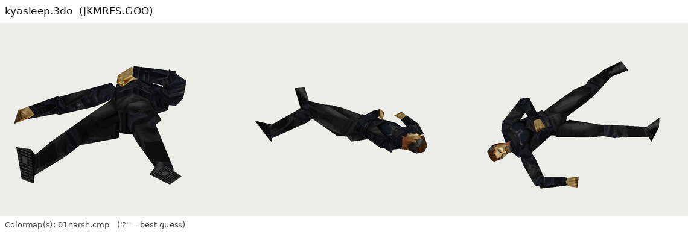

*kyasleep.3do: sleeping Kyle (unreferenced; Kyle models are used)*

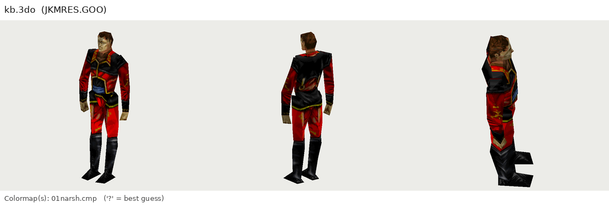

*kb.3do: Kaerobani body (the used MP skin is KYkb.3do)*

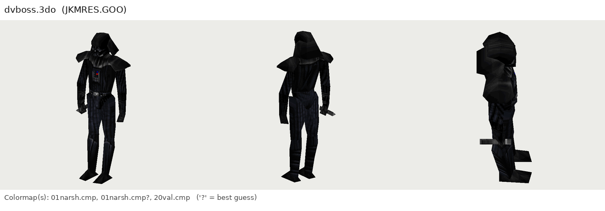

*dvboss.3do: LOD copy of the used kydarth.3do*

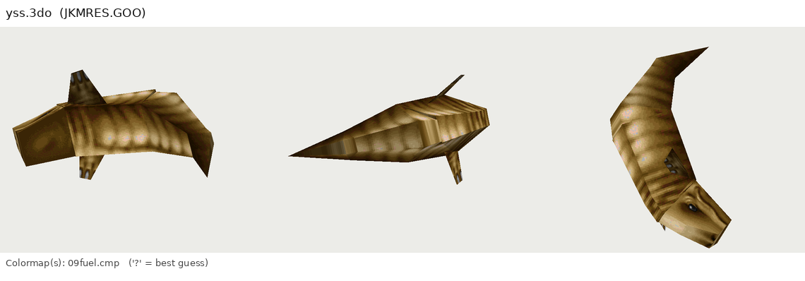

*yss.3do: ysalamiri shoulder export (the used ysalamiri is ys.3do)*

<a id="section-f"></a>
## F. Headers, dates and development machines

<a id="finding-25"></a>
### 25. Level save dates

**Rating:** Partly known

| Game | Archive | Internal path / files |
|---|---|---|
| JK | Episode\JK1.GOB, JK1CTF.GOB, JK1MP.GOB | jkl\*.jkl (first line) |
| MotS | Episode\JKM*.GOO; Resource\VIDEO\*.ZIP | jkl\*.jkl (first line) |

Every JKL starts with a "World file ... Created" stamp. JK levels are dated 2-9 September 1997, saved from both C:\ and D:\Jedi\Products\JK\Release\. MotS levels are dated 11-16 January 1998. The MotS cutscene levels run from 29 November 1997 to 2 January 1998. The hidden S6L1 was saved on 11 January 1998, the same window as the shipped MotS levels, so it was finished alongside them. static.jkl in both games is dated 30 October 1996.

**Evidence**

```
#********** World file D:\jedi\Products\JkMiss\Release\Episode\JKM\JKL\S6L1.jkl ***** Created 1/11/1998 3:28pm **********
```

**Sources**

- Full list in [jkl_headers.csv](references/jkl_headers.csv). Some dates are quoted in community posts.

<a id="finding-26"></a>
### 26. Internal project name and personal folders

**Rating:** Partly known

| Game | Archive | Internal path / files |
|---|---|---|
| JK | Resource\Res2.gob | 3do\ligt.3do |
| MotS | all archives | 3DO / JKL source paths |

MotS is called "JkMiss" in every path. Personal folders leak into a few headers: `D:\working\CLINTS\Ligt.prj` and `E:\duClem\3x8d.prj` (MotS). Exporter versions range from ver2.22 to 4.65. Cog author tags include YB (270+ cogs), KS, RD, IS, CR, DB, SXC, MT and JS.

ligt.3do is an earlier export of the Force Lightning segment. The effect is used in both games: the +force_ltpeice template uses **ligt2.3do**, which has the same single texture (ligt3.mat) and the same 30 vertices and comes from the official Weapons\ForceWeapons\ForceBolt folder. ligt2.3do appears in JK levels 03, 07, 14, 15, 17a, 19a, 21a, the CTF maps and MotS s2l2b and cutscenes. Only the personal-folder copy, ligt.3do, is unreferenced.

**Community theory (Shimstock) - Speculative, not yet linked by any file.** Community modder Shimstock suggested: "The unused lightning 3do might've been the Tusken prod projectile." What the data shows: ligt.3do is a single lightning strip (one texture, LIGT3.MAT; 30 vertices, 26 faces) exported from a personal folder with ver4.50, older than the ligt2.3do the Force Lightning effect uses (official Weapons\ForceWeapons\ForceBolt folder, ver4.63). The cut prod does leave a slot behind: JK items.dat keeps tusken_prod in slot 5, wired to weap_crossbow.cog, and MotS keeps it in slot 135 with weap_crossbow_m.cog. No file names ligt.3do together with the prod, and no file states which effect ligt.3do was meant for, so no file confirms or rules this out yet.

**Evidence**

```
ligt.3do:  # MODEL 'Ligt.3do' created from 'D:\working\CLINTS\Ligt.prj in VISUAL mode with ver4.50.'
ligt2.3do: # MODEL 'Ligt2.3do' created from 'D:\Jedi\Products\JK\Data\3DO\Weapons\ForceWeapons\ForceBolt\Ligt2.prj ... ver4.63.'
m2.jkl (JK1MP.GOB): ... type=weapon move=physics timer=0.25 model3d=ligt2.3do size=0.005 ...
JK Res2.gob misc\items.dat:16  tusken_prod  5  0  1  0x0a4  cog=weap_crossbow.cog
MotS JKMRES.GOO misc\items.dat:36  tusken_prod  135  0  1  0x0a4  cog=weap_crossbow_m.cog
```

**Sources**

- Full list in [3do_dev_source_paths.csv](references/3do_dev_source_paths.csv). Community theory on ligt.3do: Community modder Shimstock.

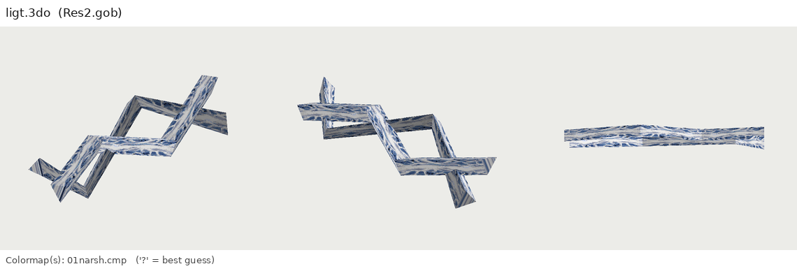

*ligt.3do: earlier copy of the Force Lightning segment (the game uses ligt2.3do)*

<a id="finding-27"></a>
### 27. Colormaps no level loads

**Rating:** Likely new

| Game | Archive | Internal path / files |
|---|---|---|
| MotS | Resource\JKMRES.GOO | misc\cmp\41escort.cmp, misc\cmp\01narsh2.cmp |
| JK | Resource\Res2.gob | misc\cmp\12redmap.cmp, m4redmap.cmp |

MotS level s4l1 (the escort ship) uses 01narsh.cmp, so its own 41escort.cmp went unused. 01narsh2.cmp is an alternate Nar Shaddaa palette. JK ships 12redmap.cmp and m4redmap.cmp (red variants). None of these four names appears in any file of either game.

dflt.cmp was dropped from this list: JK's copy is unreferenced, but MotS ships its own (different) dflt.cmp and the cutscene level s4l2_ocs loads it.

**Evidence**

```
cutscenes.goo\jkl\s4l2_ocs.jkl: 0: dflt.cmp
See cross_game_verification.csv (ext = cmp).
```

**Sources**

- No earlier source found.

<a id="finding-28"></a>
### 28. Gaps in the MotS episode list

**Rating:** Partly known

| Game | Archive | Internal path / files |
|---|---|---|
| MotS | Episode\JKM.GOO | episode.jk |

MotS episode.jk plays SMUSH (.san) cutscenes. The line numbers jump from 141 to 310 (there is no scenario 3) and from 331 to 420 (no s5l1). Comments are stale: s5l2_darkswamp is labeled "Scenario 4, Level 2" and s2l2b is labeled "Scenario 2, Level 3".

**Evidence**

```
141:  1  7  CUT    s2l4ecs.san  0 0 310 310
310:  1  8  LEVEL  s4l1_EscortShip.jkl ... # Scenario 4, Level 1
331:  1 10  CUT    s4l3ecs.san  0 0 420 420
420:  1 11  LEVEL  s5l2_darkswamp.jkl  ... # Scenario 4, Level 2
```

**Sources**

- Scenario numbering has been discussed in the community; the exact gaps were not found documented.

<a id="section-g"></a>
## G. Hints in comments

When the asset lists were built, comment lines were skipped on purpose, because a commented-out line does not make the game load anything. This section reads those comments on their own terms. Every comment in both games was extracted: the # and // comments in cogs, levels (including static.jkl, the cutscene levels and S6L1), templates, puppets, sound sets, AI, particle and sprite files, the .dat, .per, .uni and episode.jk files, and the export headers of every 3DO and KEY file. That came to 172,343 comment lines, of which 36,307 are more than table headers or column labels.

Each comment was scanned for file names, template names, old level numbers, dates and initials, words such as "old", "removed", "was", "temp" or "hack", and commented-out code. Every file or template name found this way was checked against both games, as in the rest of this document. 6,688 lines were flagged; they are listed in [comments_flagged.csv](references/comments_flagged.csv), and all extracted comments are in [comments_all.csv](references/comments_all.csv).

Each finding below is classified. **Confirmed cut**: the comment shows that something was removed or disabled, and the data confirms it. **Likely rename**: the comment gives an older name, number or source for something that shipped. **Speculative**: the comment hints at something, but the data cannot settle what. **Dev notes**: dates, initials and working notes. Comments can be stale or copied from other files, so none of these is proof of intent.

<a id="finding-29"></a>
### 29. Two level numberings in the JK episode and string files

**Rating:** Partly known  ·  Classification: **Likely rename**

| Game | Archive | Internal path / files |
|---|---|---|
| JK | Episode\JK1.GOB | episode.jk |
| JK | Episode\JK1.GOB | misc\cogstrings.uni |
| JK | Episode\JK1.GOB | cog\06a_startlevel.cog |

The comments in JK's episode.jk number the 21 shipped levels one after another: 06ABarons.jkl is "Level 5", 06BBarons.jkl is "Level 6", 14tower.jkl is "Level 13" and 17asarris.jkl is "Level 16". The section headers in cogstrings.uni keep the old file numbers instead and simply skip two of them: "Level 4 - Escape Morgan's House" is followed by "Level 6a - Barons Hed", and "Level 12" is followed by "Level 14 - The tower Approach". 06a_startlevel.cog still says it starts the music "for level 5".

The two missing numbers are exactly the two cut levels: 05 (the speeder-bike chase) and 13. The file names kept the original slots, and the player-facing numbering was closed up after the cuts. The cogstrings.uni headers also call the Katarn home "Morgan's House" and level 8 "Escape the Ballroom".

**Evidence**

```
episode.jk:26  51:      1     5        LEVEL    06ABarons.jkl     0           0           60    -1    # Level 5: Barons Hed
episode.jk:48  131:     1     13       LEVEL    14tower.jkl       26          31          140   -1    # Level 13: Tower [Persuasion/Grip]
misc\cogstrings.uni:67  #  Level 4 - Escape Morgan's House - messages.
misc\cogstrings.uni:78  #  Level 6a - Barons Hed - messages.
misc\cogstrings.uni:145  #  Level 12 - Escape the Cargo Ship - messages.
misc\cogstrings.uni:155  #  Level 14 - The tower Approach - messages.
cog\06a_startlevel.cog:5  # Start music for level 5
```

**Sources**

- The gaps in the level file numbering (no 05, no 13) are known; see community modder KnightCop's PDF and TCRF. No online mention of these comment labels was found.

<a id="finding-30"></a>
### 30. Level 19A objectives that were rewritten

**Rating:** Likely new  ·  Classification: **Confirmed cut (reworded)**

| Game | Archive | Internal path / files |
|---|---|---|
| JK | Episode\JK1.GOB | misc\cogstrings.uni |

Two of the 19A objectives in cogstrings.uni are commented out and replaced on the next line. The original goal 0 was "Lower the payload through the cargo doors so you can jump down to the sublevels." It became "Find the safe entrance to sub level 2", and the payload instruction moved into goal 1, which originally only said the control room would "work past the cargo staging area". The level was rearranged so that the payload drop comes after the control room.

**Evidence**

```
misc\cogstrings.uni:213  #  "GOAL_19000"   0  "Lower the payload through the cargo doors so you can jump down to the sublevels."  # Goal 0
misc\cogstrings.uni:214  "GOAL_19000"   0  "Find the safe entrance to sub level 2."                              # Goal 0
misc\cogstrings.uni:216  #  "GOAL_19001"   0  "The control room will allow you to work past the cargo staging area." # Goal 1
misc\cogstrings.uni:217  "GOAL_19001"   0  "The control room will allow you to lower the payload through the cargo doors so you can jump down to the sublevels." # Goal 1
```

**Sources**

- No online mention found.

<a id="finding-31"></a>
### 31. Commented-out control functions: Game Restore, Game Record and Debug

**Rating:** Likely new  ·  Classification: **Speculative**

| Game | Archive | Internal path / files |
|---|---|---|
| JK | Resource\Res1hi.gob | ui\jkstrings.uni |

In the list of bindable control functions in jkstrings.uni, three entries are commented out right after "Quick Save": "Game Restore", "Game Record" and "Debug". "Game Record" suggests a demo-recording key that was planned or used in development and then hidden. The file header also carries a note from [WW], dated 12/5/1996, saying the strings will be converted to Unicode "when we find a UNICODE editor".

What these functions did is not known from the data. The executable, which would show whether the code behind them survives, was not available for this survey.

**Evidence**

```
ui\jkstrings.uni:684  "GAMESAVE"        0 "Quick Save"
ui\jkstrings.uni:685  #   "GAMERESTORE"     0 "Game Restore"
ui\jkstrings.uni:686  #   "GAMERECORD"      0 "Game Record"
ui\jkstrings.uni:687  #   "DEBUG"           0 "Debug"
ui\jkstrings.uni:4  # to UNICODE when we find a UNICODE editor. [WW] 12/5/1996
```

**Sources**

- No online mention found. The Sith engine UNI format is documented on the "Jedi Knight Sith Engine Specs" wiki (jksith.wikidot.com).

<a id="finding-32"></a>
### 32. Officer and trooper voice lines that were listed but never shipped

**Rating:** Likely new  ·  Classification: **Confirmed cut**

| Game | Archive | Internal path / files |
|---|---|---|
| JK | Resource\Res2.gob | misc\snd\io.snd |
| JK | Resource\Res2.gob | misc\snd\st.snd |
| JK | Resource\Res2.gob | misc\snd\gr.snd |

Each JK sound set (.snd) ends with a commented list of the voice clips meant for that character, with what each line says. 44 of the listed files are in no JK archive and in none of the MotS archives available here. The officer sets (io.snd and io2.snd) list "TK421, anything to report?", "Don't let him get to the valley core.", "I want every part of this ship checked." and "He's somewhere on this ship. Find him." None of these four was found in any JK archive. The stormtrooper set (st.snd, copied into s3.snd and s4.snd) lists a short exchange, "Did you hear something?" / "You smell something?" / "No, you're imagining things.", whose three files also never shipped, although the next lines in the same conversation did.

Greedo's set (gr.snd) lists four Rodian lines (I00GR11T, U, V, W) that are missing, and mn1.snd lists "Long live the rebellion" for a file that is missing. Two listed civilian clips, i00wm02z ("Run!") and i00wm03z ("No Blasters! No Blasters!"), do exist but nothing plays them. ic.snd and icrpt.snd reuse the trooper list word for word under other file names, so their missing entries are most likely variants that were never recorded rather than different lines.

MotS's own voice archive was not available, so these files could not be looked for there. MotS uses its own voice files, so it is unlikely to hold them.

**Evidence**

```
misc\snd\io.snd:41  # i00o102z.wav    # Don't let him get to the valley core.
misc\snd\io.snd:42  # i00o103z.wav    # I want every part of this ship checked.
misc\snd\io.snd:45  # i00o106z.wav    # TK421, anything to report?
misc\snd\io.snd:47  # i00o108z.wav    # He's somewhere on this ship. Find him.
misc\snd\st.snd:68  # i00s104z.wav  # Did you hear something?
misc\snd\st.snd:90  # I00S126Z.WAV  # You smell something?
misc\snd\st.snd:97  # i00s201z.wav  # No, you're imagining things.
misc\snd\gr.snd:57  ## I00GR11U.WAV  # tah boni tom ket sa infa dite
```

**Sources**

- The Massassi Temple sound tutorial shows the same st.snd comment format. No online mention of these specific missing lines was found.

<a id="finding-33"></a>
### 33. "Cling Vines": a complete cut swamp creature in MotS

**Rating:** Likely new  ·  Classification: **Confirmed cut**

| Game | Archive | Internal path / files |
|---|---|---|
| MotS | Resource\JKMRES.GOO | 3do\vv.3do, vvalt.3do; misc\pup\vv.pup; misc\snd\vv.snd, vv2.snd; 3do\key\vvatk, vvcrm01, vvcrmb, vvdown, vvgtup, vvstn.key; 3do\mat\vvvine.mat |

MotS ships a creature called "Cling Vines". The name appears only in comments: the puppet header reads "puppet file for Cling Vines (VV.3do)" and the second sound set is headed "ClingVines foley description". The set is complete: two models (vv.3do and vvalt.3do), a puppet, two sound sets, and creep, attack, down, stand and get-up animations. Nothing in either game loads any of it.

The vine shares its leaf and spike textures (vvleaf.mat, vvspike.mat) with the Dart Flower (vf.3do), which is used in s5l2_darkswamp and s5l4_lowersith. Its own vvvine.mat is unused. It was probably meant as a hazard for the same swamp.

**Evidence**

```
misc\pup\vv.pup:1  #puppet file for Cling Vines (VV.3do)
misc\snd\vv2.snd:1  # ClingVines foley description
misc\pup\vv.pup:3  stand           VVdown.key    0x00    0    0    # standing
```

**Sources**

- No online mention found (Massassi MotS 3DO index and forums searched).

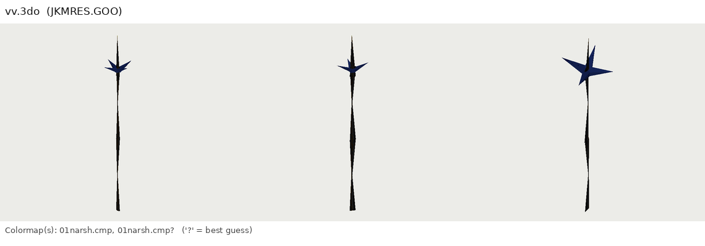

*vv.3do in its rest pose (vvvine.mat colormap is a guess)*

<a id="finding-34"></a>
### 34. A purple stormtrooper variant (s5.3do)

**Rating:** Likely new  ·  Classification: **Speculative**

| Game | Archive | Internal path / files |
|---|---|---|
| MotS | Resource\JKMRES.GOO | 3do\s5.3do; misc\pup\s5.pup; 3do\mat\s5shpad.mat; 3do\key\s5stand.key, s5fire.key |

s5.pup is headed "puppet control file for purple alt. stormtrooper with no gun in hand (s5.3do)". s5.3do is a stormtrooper with a backpack and a shoulder pad that uses its own texture, s5shpad.mat. The model, the puppet, the shoulder texture and two of its animations (s5stand.key, s5fire.key) are unreferenced in both games. A different file, s5punch.key, is used by the MotS stormtroopers. What the purple trooper was for is not stated anywhere.

The model header shows it is MotS work, not a JK leftover: it was saved in the MotS project folder (`E:\Jedi\Products\JkMiss\Data\3do\SimChars\Stormtrooper\S5.3do`, ver4.63), and its s5stand and s5fire animations were exported with ver4.65. s5 and all of its files ship only in MotS.

**Community theory (Shimstock) - Speculative.** Community modder Shimstock suggests the s5 trooper was made to fire the E-Web: "The s5 stormtrooper looked like it was made to shoot the discarded eweb gun... if you ever watched the s5 stormtrooper animation, he recoils like he is shooting an eweb from ESB. The eweb was replaced by the blaster cannon. That's why its weapon cog is called eweb."

What the data shows. For it: the puppet says "no gun in hand", yet its fire mode plays its own s5fire.key (7 frames at 15 fps). In that animation the whole body jolts: the torso pitches about 8 degrees, the head about 18, the forearms 7-9, and the legs move. That is a full-body recoil rather than a rifle shot, which fits a trooper firing a mounted gun.

The E-Web itself is in MotS: weap_eweb_m.cog ("WEAPON 10 script - EWEB Gun", "Player can not move when using this weapon", by [YB & CYW]), items.dat slots EWEB (130) and para_EWEB, and the models eweb.3do, eweb0.3do (projectile) and ewebbase.3do, all from `E:\Jedi\Products\JkMiss\Data\3do\Weapons\EWEB\` (ver4.63). It is placed in s1l2_astcrust, s4l1_escortship and s4l2_shipyards and in multiplayer and saber maps. Players know it as the "RMF-31 Repeating Blaster Cannon" (MotS manual), and the pickup message (string 382, pow_eweb_m.cog) is "The Blaster Cannon!", while every internal name stays EWEB. Its textures are named bc* (probably "blaster cannon") and exist only in MotS. So "replaced" is best read as renamed: the E-Web was not swapped for another gun, it was given a new player-facing name.

JK has no E-Web trace at all: no cog, model, texture or string, and JK's weapon slot 10 is the lightsaber (MotS moved the saber to make room). No file names s5 together with the E-Web, and no level or template uses s5, so the link stays a theory.

**Evidence**

```
misc\pup\s5.pup:1  # puppet control file for purple alt. stormtrooper with no gun in hand (s5.3do)
3do\s5.3do:1  # MODEL 'S5.3do' created from 'E:\Jedi\Products\JkMiss\Data\3do\SimChars\Stormtrooper\S5.3do in VISUAL mode with ver4.63.'
misc\pup\s5.pup:4  stand        s5stand.key    0x00    0    0    # 0 = Standing
misc\pup\s5.pup:30  fire         s5fire.key    0x28    1    5    # 10 = fire
3do\key\s5fire.key:1  # KEYFRAME '<unnamed>' created from 'S5fire.prj in BATCH mode with ver4.65.'
cog\weap_eweb_m.cog:5  # WEAPON 10 script - EWEB Gun
cog\weap_eweb_m.cog:7  # Player can not move when using this weapon.
cog\weap_eweb_m.cog:11  # [YB & CYW]
misc\items.dat:30  EWEB                    130             0       32000   0x0b4   cog=weap_EWEB_m.cog
cog\pow_eweb_m.cog:41  jkPrintUNIString(player, 382);    // The Blaster Cannon!
3do\eweb.3do:1  # MODEL 'Eweb.3do' created from 'E:\Jedi\Products\JkMiss\Data\3do\Weapons\EWEB\Eweb.3do in VISUAL mode with ver4.63.'
```

**Sources**

- No online mention of s5 found. Community theory: Community modder Shimstock.

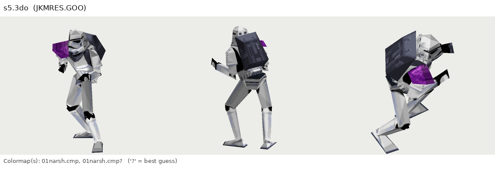

*s5.3do (colormap is a best guess; the purple pad matches the puppet comment)*

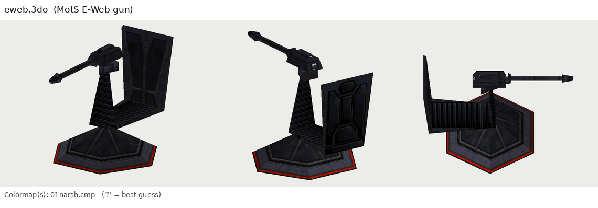

*eweb.3do, the MotS E-Web / "Blaster Cannon" turret the theory refers to*

<a id="finding-35"></a>
### 35. Kill the Fool with the Ysalamiri: a bobbing animation and a deathmatch mode, switched off

**Rating:** Likely new  ·  Classification: **Confirmed cut**

| Game | Archive | Internal path / files |
|---|---|---|
| MotS | Episode\JKM_KFY.GOO | cog\kfy_main.cog |
| MotS | Resource\JKMRES.GOO | 3do\key\ysbobbin.key |

kfy_main.cog, the script behind the five MotS "Kill the Fool with the Ysalamiri" maps, declares a ysalamiri animation, YSbobbin.key, on a commented-out line, and the call that would play it is commented out as well. ysbobbin.key ships in JKMRES.GOO but nothing loads it. The same script keeps a block marked "Old stuff to play KFY levels as DM levels", which shows the KFY maps were also meant to be playable as ordinary deathmatch maps.

**Evidence**

```
cog\kfy_main.cog:88  #keyframe    ysalamiri_anim=YSbobbin.key      local
cog\kfy_main.cog:126  // Old stuff to play KFY levels as DM levels
cog\kfy_main.cog:218  // PlayKey(ysalamiri, ysalamiri_anim, 1, 0);
3do\key\ysbobbin.key:1  # KEYFRAME 'Ysbobbin.key' created from 'E:\Jedi\Products\JkMiss\Data\3do\SimChars\Ysalamiri\ground\anims\Ysbobbin.prj in VISUAL mode with ver4.63.'
```

**Sources**

- No online mention found.

<a id="finding-36"></a>
### 36. MotS finale: disabled subtitles and a third model swap

**Rating:** Likely new  ·  Classification: **Confirmed cut (disabled)**

| Game | Archive | Internal path / files |
|---|---|---|
| MotS | Resource\VIDEO\CUTSCENES.ZIP > cutscenes.goo | cog\s5_finale.cog |

In s5_finale.cog, all eight on-screen text calls for the final conversation (strings 95001 to 95008) are commented out, while the matching voice lines still play. None of those string numbers is in any .uni file of either game available here, so the subtitle text was apparently never added rather than just switched off.

The finale swaps Kyle for the "kylebossactor" model (kkduel.3do with the mjdueling.pup puppet) twice. A third swap, after "I was deluded...", is commented out.

**Evidence**

```
cog\s5_finale.cog:117  //   jkPrintUNIString(-1, 95001);
cog\s5_finale.cog:188  // jkPrintUNIString(-1, 95005);
cog\s5_finale.cog:195  //   thing1 = CreateThing(kboss, Kyle);
cog\s5_finale.cog:33  template    kboss=kylebossactor              local
```

**Sources**

- The fan "Mysteries of the Sith Remastered" mod adds its own subtitles for the engine cutscenes; it does not mention these disabled calls.

<a id="finding-37"></a>
### 37. S6L1 was built from the S1L1 scripts

**Rating:** Partly known  ·  Classification: **Likely rename**

| Game | Archive | Internal path / files |
|---|---|---|
| MotS | Resource\VIDEO\UNSUPPORTED.ZIP | cog\S6L1_endlevel.cog |
| MotS | Resource\VIDEO\UNSUPPORTED.ZIP | cog\S6L1_tiefighter.cog |

Several cogs in the hidden S6L1 level keep S1L1 headers. S6L1_endlevel.cog is described as the "Endlevel cog for level S1L1", still has S1L1's cutscene call commented out (s1l1ocs.san) and its comment "This is the first level". It also has a disabled "Extra stars here" line that would have given 5 star points. Both S6L1_tiefighter cogs are headed "S1L1_tiefightr2.cog", and one of them has a second TIE bomber commented out.

**Evidence**

```
cog\S6L1_endlevel.cog:5  # Endlevel cog for level S1L1
cog\S6L1_endlevel.cog:49  //jkStartupCutscene ("s1l1ocs.san");
cog\S6L1_endlevel.cog:88  //SetInv(player, 17, 5.0);
cog\S6L1_tiefighter.cog:3  # S1L1_tiefightr2.cog
cog\S6L1_tiefighter.cog:41  //vtiebomber2=creatething(bombertemplate, bomberdummy1);
```

**Sources**

- S6L1 itself is known (Steam community guide). No online mention of these script leftovers was found.

<a id="finding-38"></a>
### 38. The TIE bomber script says "level 04"

**Rating:** Likely new  ·  Classification: **Speculative**

| Game | Archive | Internal path / files |
|---|---|---|
| JK | Episode\JK1.GOB | cog\08_tiebomber.cog |
| MotS | Episode\JKM.GOO | cog\s1l1_tiefighter.cog |

JK's 08_tiebomber.cog by [MT] is used in level 8 (08escape88.jkl), but its header says "Tiebomber cog for level 04". The MotS copies (s1l1_tiefighter*.cog and the S6L1 ones) inherit the same line. The header may simply be wrong. Another possibility is that the script was first written for an earlier level 4 or 5. The cut speeder-bike chase had its own TIE bomber animation (05vtiebm, see finding 2), but nothing in the data links the two.

**Evidence**

```
cog\08_tiebomber.cog:5  # Tiebomber cog for level 04
cog\08_tiebomber.cog:9  # [MT]
cog\s1l1_tiefighter.cog:5  # Tiebomber cog for level 04
```

**Sources**

- No online mention found.

<a id="finding-39"></a>
### 39. Script names in headers that differ from the shipped names

**Rating:** Likely new  ·  Classification: **Likely rename**

| Game | Archive | Internal path / files |
|---|---|---|
| JK | Episode\JK1.GOB | cog\04_remotes.cog |
| JK | Episode\JK1.GOB | cog\20_bocsearch.cog |
| MotS | Episode\JKM.GOO | cog\s4l3_kaerobanihalls_elev.cog |
| MotS | Episode\JKM.GOO | cog\s5l4_coffin.cog |
| MotS | Episode\JKM.GOO | cog\s1l3_elev_switch.cog |

56 cog headers name a .cog file that exists in neither game. Most of them are the file's own earlier name. Examples: 04_remotes.cog was "04_startup.cog"; 00_aisidekick.cog was "00_Sidekick.cog"; 20_bocsearch.cog was "17a_BocSearch.cog" (the 17a prefix matches the Sariss level's own search script, 17a_sarrisssearch.cog; both say they were "Modified from 00_AISearchPath.cog"); s4l3_looks_like_trouble.cog was "s4l3_i_dont_like.cog"; s4l3_kaerobanihalls_elev.cog was "S4L3_KChamber_elev.cog"; s5l4_coffin.cog was "S5L4_KyleCoffin.cog"; force_chainlight.cog was "FORCE_CLIGHTNING.COG".

One header points outside the single-player game. s1l3_elev_switch.cog says it was "copied M8_elev_switch.cog, and renamed it for use in JK Missions' S1L3" on 8/14/97. JK's multiplayer GOB ships only m2, m4, m5 and m10 (plus two m_boss levels), and there is no M8_elev_switch.cog in either game, so a JK multiplayer level "M8" seems to have existed in development.

**Evidence**

```
cog\04_remotes.cog:3  # 04_startup.cog
cog\20_bocsearch.cog:3  # 17a_BocSearch.cog
cog\20_bocsearch.cog:4  #    Modified from 00_AISearchPath.cog for the Boc level
cog\s4l3_kaerobanihalls_elev.cog:1  ## S4L3_KChamber_elev.cog
cog\s5l4_coffin.cog:3  # S5L4_KyleCoffin.cog
cog\s1l3_elev_switch.cog:13  ## Modified 8/14/97 by Chris K (copied M8_elev_switch.cog, and renamed it for use in JK Missions' S1L3)
```

**Sources**

- The full list is in [comments_flagged.csv](references/comments_flagged.csv) (flag asset_not_used_or_missing on header lines). No online mention found.

<a id="finding-40"></a>
### 40. Source names inside model and animation headers

**Rating:** Partly known  ·  Classification: **Likely rename**

| Game | Archive | Internal path / files |
|---|---|---|
| MotS | Resource\JKMRES.GOO | 3do\sw.3do |
| MotS | Resource\JKMRES.GOO | 3do\key\wsatk1.key |
| JK | Resource\Res2.gob | misc\pup\ja.pup |
| MotS | Resource\JKMRES.GOO | misc\pup\statue0.pup |
| MotS | Resource\JKMRES.GOO | misc\pup\statue1.pup |
| MotS | Resource\JKMRES.GOO | misc\pup\mjdueling.pup |

The export headers of 3DO and KEY files keep the artist's working names:

- The MotS swamp lurker sw.3do was made from JK's dianoga ("Octopus\Oc.prj"), and its attack, idle and sting animations were exported from OC* files.

- The swamp wampa animations come from a "SimChars\WampaCliff" folder with wc* names, so the creature began as a cliff wampa. The puppet calls it "Wampa-swamp".

- The vornskr animations were exported as VO* and renamed vr*.

- JK's Jan model ja.3do is an export of a Kyle LOD mesh ("K10-0"), and ja.pup says "Kyle with Jan textures!".

- The MotS Sith statues reuse JK puppets: statue0.pup "was Yun" and statue1.pup "was Jerec". Both still play the YU* and JE* animations.

- The purple, green and orange thrown-saber models are all exports named "Sab0red".

- The AT-ST transport key 04vatrn.key was exported as "04vastrn" from a "Ships\ATSTtransport" folder.

One puppet comment says the opposite of a rename. Mara's puppets note that Kyle's second idle fidget "kyidle1b.key was shaving", which is why her puppets use a different fidget.

**Evidence**

```
3do\sw.3do:1  # MODEL 'Oc.3do' created from 'D:\Jedi\Products\JK\Data\3DO\SimChars\Octopus\Oc.prj in VISUAL mode with ver4.63.'
3do\key\wsatk1.key:1  # KEYFRAME 'wcATK1.key' created from 'E:\Jedi\Products\JkMiss\Data\3do\SimChars\WampaCliff\anims\wcATK1.key in VISUAL mode with ver4.63.'
misc\pup\ja.pup:1  # puppet control file for JA.3do (Kyle with Jan textures!)
misc\pup\statue0.pup:1  #puppet file for statue0 (S0.3do) ; was Yun
misc\pup\statue1.pup:1  #puppet file for statue1 (S1.3do) ; was Jerec
misc\pup\mjdueling.pup:57  fidget2        kyidle1.key    0x20    1    1    # submode 25 = fidget2 \\ kyidle1b.key was shaving
```

**Sources**

- Reuse of JK creatures in MotS is broadly known. These specific source names were not found online.

<a id="finding-41"></a>
### 41. Change logs: dates, initials and an early start on MotS

**Rating:** Partly known  ·  Classification: **Dev notes**

| Game | Archive | Internal path / files |
|---|---|---|
| JK | Resource\Res2.gob | cog\00_elev_switch.cog |
| JK | Resource\Res2.gob | cog\actor_ic.cog |
| JK | Resource\Res2.gob | misc\pup\bo.pup |
| MotS | Episode\JKM.GOO | cog\s5l4_elev_switch.cog |
| MotS | Episode\JKM.GOO | cog\s1l3_elev_switch.cog |
| MotS | Resource\VIDEO\CUTSCENES.ZIP > cutscenes.goo | cog\s1l1_endcustscene.cog |
| MotS | Episode\JKM.GOO | cog\s2l1_droideye.cog |

Cog and data headers carry dated change notes with developer initials or first names, including DS / D.Shannon, RKD, IS / Ingar, JS, SXC, YW, CR, YB, DB, MT / M.Tateishi, WW, Anthony, Chris K / Chris Klie and Tim L. JK entries run from 10/30/1996 (static.jkl) through 9/1/1997. Examples: "7/28/97 [CR] Doubled saber damage for single player gameplay reasons" on the Imperial commando; "Ingar: modified 5/16/97 removed officer/key" on a level 12 elevator.

MotS ("JK Missions" in the comments, "JkMiss" in paths) was being built before JK shipped in October 1997. An elevator cog was "renamed for Jkm" on 8/10/97, S1L3's switch was copied for "JK Missions' S1L3" on 8/14/97, and S1L1's rebel generator was modified on 8/22/97. Some dates were inherited when files were copied: s1l3_elev_switch.cog repeats the JK entries from 11/13/96 onward.

The cutscene scripts also contain placeholder names: S1L1's ending cutscene has disabled debug prints "shoot kevin" and "shoot ryan", S1L2's has a thing called "steveshoot2", and a Palace droid script notes that it worked "until the testers got a hold of it".

**Evidence**

```
cog\00_elev_switch.cog:11  # Modified 11/13/96 DS  (added third adjoin)
cog\00_elev_switch.cog:17  # Modified 9/1/97 by SXC (took blocked message out)
cog\actor_ic.cog:9  # 7/28/97 [CR] Doubled saber damage for single player gameplay reasons
misc\pup\bo.pup:1  #puppet file for Boc (bo.3do) [Anthony 12/20/96]
cog\s5l4_elev_switch.cog:3  # Modified 8/10/97 by Tim L. (added one more adjoin for access from all 4 sides.) --also renamed for Jkm.
cog\s1l3_elev_switch.cog:13  ## Modified 8/14/97 by Chris K (copied M8_elev_switch.cog, and renamed it for use in JK Missions' S1L3)
cog\s1l1_endcustscene.cog:107  //    Print("shoot kevin");
cog\s2l1_droideye.cog:6  # Otherwise, it won't.  At least it did until the testers got a hold of it.
```

**Sources**

- The JkMiss name and level save dates are covered earlier in this document; the 1997 dates and the "JK Missions" name were not found online.

<a id="section-h"></a>
## H. Added after community feedback

These two findings were added after community modder KnightCop reviewed the first published version. Thank you to KnightCop for the corrections and pointers; the full list of changes from that review is in Appendix G.

<a id="finding-42"></a>
### 42. 03trcr.3do: the little tractor from the Katarn farm

**Rating:** Partly known

| Game | Archive | Internal path / files |
|---|---|---|
| MotS | Resource\JKMRES.GOO | 3do\03trcr.3do; 3do\mat\03trcrww.mat, 03trcrar.mat, 03trcrtp.mat, 03trcrsd.mat, 03trcrtd.mat |

Community modder KnightCop pointed out a small tractor model that the first version of this document did not describe. It is 03trcr.3do ("trcr" = tractor): a boxy rust-orange body on two big hexagonal wheels, with a long perforated boom. It is one mesh with 115 vertices and five textures of its own.

The 03 prefix is JK level 3 (03katarn, the Katarn farm), and the header says it was exported from `Environment\Tractor3` in the JK data folder with exporter ver2.31, one of the earliest versions in the data. The mesh inside is named 04trcr, so it may have been meant for level 4 (04escapehouse) at some point. "Tractor3" suggests there were earlier versions.

JK does not ship this model or its textures at all. MotS ships them in JKMRES.GOO, but nothing loads them: the name (with and without the extension, and as a substring) appears in no level of either game (single player, multiplayer, CTF, Kill the Fool, cutscene levels, S6L1), no template, cog, puppet, sound set, particle or sprite file, and there is no identical copy under another name. Its five textures are used only by this model.

Why it was missed: it was in [mots_unreferenced_assets.csv](references/mots_unreferenced_assets.csv) from the start, but it was not picked for a write-up.

**Evidence**

```
03trcr.3do:1  # MODEL '03TRCR.3do' created from 'D:\Jedi\Products\JK\Data\3DO\Environment\Tractor3\03TRCR.prj in VISUAL mode with ver2.31.'
MATERIALS 5:  03TRCRWW.MAT  03TRCRAR.MAT  03TRCRTP.MAT  03TRCRSD.MAT  03TRCRTD.MAT
MESH 0  NAME 04trcr  VERTICES 115
References in JK and MotS (code, comments, substrings): none outside the model itself
```

**Sources**

- Pointed out by community modder KnightCop. No published note naming the file was found.

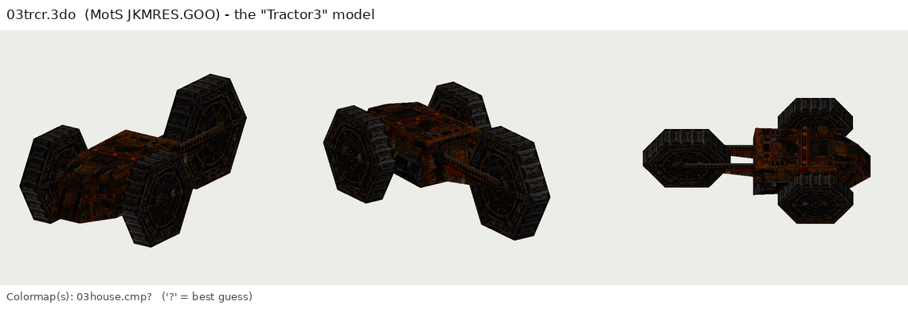

*03trcr.3do with its own textures (colormap 20val.cmp is a best guess; closest match to community modder KnightCop's screenshot. 03house.cmp, which JK level 3 uses with the other 03 textures, makes the rust too dark)*

<a id="finding-43"></a>
### 43. Unused Katarn farm and house textures that only MotS ships

**Rating:** Partly known

| Game | Archive | Internal path / files |
|---|---|---|
| MotS | Resource\JKMRES.GOO | mat\03wswt1a-d.mat, 03went.mat, 03went1.mat, 03went2.mat, 03wstr1a.mat, 03wstr1c.mat, 03pict1d.mat, and 119 more 03*/04* textures ([katarn_home_mats.csv](references/katarn_home_mats.csv)) |

Community modder KnightCop also mentioned the many unused textures from Morgan Katarn's home. The ones in his screenshots were matched pixel for pixel against every texture in both games:

**03wswt1a, 03wswt1b, 03wswt1c, 03wswt1d** (wood wall panels with inset gadgets), **03went** (dark console with screen), **03went1** and **03went2** (the two dark panels next to it), **03wstr1a** (wood-framed TV), **03wstr1c** (metal vent on wood) and **03pict1d** (the red painting) ship only in MotS JKMRES.GOO and are used by neither game. JK does not ship them. The plain wood grain in the same screenshot is **03wstr1b**, which is the one exception: JK ships it and uses it in level 3 (03katarn).

A sweep of every texture with the level 3 or 4 prefix in both games (272 names) found 129 that ship only in MotS and are used by neither game: 109 with the 03 prefix and 20 with the 04 prefix. Only one MotS map uses a 03 texture at all (mdm15_homestead uses 03vap1.mat). Five of them are the tractor's textures and two belong to the unused door models 03d4x4_a.3do and 04d2x3.3do. One (03c03) is a byte-identical copy of a texture JK uses (03c02), and about 15 more are near-identical variants of used JK textures. The rest are unique: alternate paintings (03pict01-04, 03pict1c/1d), wall and plate sets (03wplt01-10, 03w02*, 03w06*, 03w07*), ground and grass (03fgd*, 03fgrs*), several farm skies (03sky1/2, 03sky03k-08k, 0301sky2), cabinets, window and seat textures, and a run of 04wex* metal panels.

So these are not used in multiplayer either. It looks like the MotS team copied an older or fuller version of the JK level 3 and 4 texture folders, and JK itself shipped only the textures its final levels needed.

Why they were missed: they were in [mots_unreferenced_assets.csv](references/mots_unreferenced_assets.csv), but the contact sheet in Appendix B showed a selection that did not include them.

**Evidence**

```
Pixel match (16x16 RMS difference) between each screenshot tile and the extracted texture: 0 for all 11 tiles
03wstr1b.mat: JK Res2.gob, referenced by jk_JK1.GOB\jkl\03katarn.jkl (the only one of the 11 in JK)
03wswt1*, 03went*, 03wstr1a/1c, 03pict1d: no reference in any file of either game (code, comments or substring)
Sweep: 272 03/04 textures; 129 MotS-only and unused in both (109 with 03, 20 with 04)
```

**Sources**

- Pointed out by community modder KnightCop. Full list: [katarn_home_mats.csv](references/katarn_home_mats.csv).


*The textures in community modder KnightCop's screenshots, identified*


*All MotS-only 03/04 textures that neither game uses*

<a id="section-i"></a>
## I. Added in v2.2

These findings were added in v2.2 from community notes and a further pass over leftover templates and scripts.

<a id="finding-44"></a>
### 44. An unfinished saber throw in Jedi Knight

**Rating:** Partly known

| Game | Archive | Internal path / files |
|---|---|---|
| JK | Resource\Res2.gob | 3do\sab0.3do, 3do\mat\sabvbld.mat, 3do\key\sab0.key |
| JK | Episode\JK1.GOB (and most other JK levels) | template +force_saber (model3d=sab0.3do); no cog fires it |

`sab0.3do` is a lightsaber with a solid bright-green blade. The blade mesh uses `SABVBLD.MAT`, whose pixels are all palette index 1: pure green (0, 255, 0) in every JK colormap. Ordinary sabers in JK have no blade model, because the game draws the blade in the engine. A matching spin animation, `sab0.key` (8 frames at 15 fps, from the same Sab0 project), is referenced by no puppet, cog or level.

Almost every JK level still lists a `+force_saber` template that uses this model, but no JK cog ever calls `FireProjectile` or `CreateThing` on it, and JK has no saber-throw inventory power. Mysteries of the Sith later shipped a working saber throw (`force_saberthrow.cog`, with later models such as `sab0gree`). The green-shaft model was the experimental JK version of that idea.

This was easy to miss, and an earlier version of this document wrongly removed `sab0.3do` from the unused list because every JK level names it (see Finding 23 and Appendix F). Being listed in a level template is not the same as being fired. Cogking, a developer on the original game who helped create the COG scripting language, confirmed that the developers were experimenting with a saber throw; the green-shaft model was found in a review of this catalogue.

**Evidence**

```
sab0.3do: saber model with a solid blade mesh; material SABVBLD.MAT is 8-bit, all pixels palette index 1 (pure green in every JK colormap)
sab0.key: 8 frames, 15 fps, from the same Sab0.prj; unreferenced
+force_saber appears in almost every JK JKL; no JK cog fires it; JK items.dat has no f_saberthrow
MotS ships force_saberthrow.cog and later saber-throw models (sab0gree and related)
```

**Sources**

- Cogking, a developer on the original game who helped create the COG scripting language, confirmed that the developers were experimenting with a saber throw.
- The green-shaft model (sab0.3do in Res2.gob) was identified in a review of this catalogue.


*sab0.3do, the unused JK saber-throw model with its solid green blade (colormap JK 01narsh)*


*sab0.3do with sab0.key: the unused throw spin (all eight frames overlaid, then each frame in order)*


*sabg.3do, a normal JK in-hand saber grip with no blade mesh (the game draws the blade in the engine)*


*MotS sab0gree.3do, the later shipped saber-throw model, for comparison*

<a id="finding-45"></a>
### 45. Warning Sense: an unused MotS Force power that never got an effect

**Rating:** Likely new

| Game | Archive | Internal path / files |
|---|---|---|
| MotS | Resource\JKMRES.GOO | cog\force_warning.cog |

MotS still contains an unused Force-power script, `force_warning.cog`, titled "Warning Sense" and written for inventory bin 38. On activate it plays the standard Force-cast animation and sets player flags that the script itself comments as `JK_TF_WARNINGON` (0x400), `WARNINGLOW` (0x800) and `WARNINGHIGH` (0x1000). Rank 1 sets 0x400, rank 2 sets 0xC00, rank 3 sets 0x1400 and rank 4 sets 0x1C00. Shutting the power off clears 0x1C00. No other cog in JK or MotS sets or reads those bits: every other `jkGetFlags` check in the scripts looks only at 0x20, the Persuasion flag.

This is not an old name for a power that shipped. MotS still has a separate script for each shipped Force power. Force Push, which occupies bin 38 in the shipped `items.dat` (`f_push`, `cog=force_push.cog`), is a targeted shove cloned from Force Pull. Force Seeing, Far Sight, Persuasion and the rest are also still present as their own scripts and use different flags or effects. Nothing in `items.dat`, any level, or any other cog points at `force_warning.cog`, so the game never loads it. The script itself looks unfinished: it lists a mana cost of 5 but never spends mana, and it never starts the timer or pulse that would turn the flags off.

A temporary test in the original Mysteries of the Sith executable, hooking this script to the Force Push inventory slot, confirmed that the engine accepts and reports the flags (0x400, 0xC00, 0x1400 and 0x1C00). There was no visible change to the screen, the HUD, the Force meter or the automap; enemies still attacked, and fall damage was still taken. The flags are set, but the effect they were meant to switch on was never implemented.

**Evidence**

```
force_warning.cog header: FORCEPOWER Script - Warning Sense / Bin 38
//JK_TF_WARNINGON = 0x0400  //JK_TF_WARNINGLOW = 0x0800  //JK_TF_WARNINGHIGH = 0x1000
ranks 1-4: jkSetFlags 0x0400, 0x0C00, 0x1400, 0x1C00; stop_power: jkClearFlags 0x1C00
items.dat: f_push  38  ...  cog=force_push.cog   (no line points at force_warning.cog)
No other extracted JK or MotS cog reads 0x400, 0x800 or 0x1000
In-game test in the original MotS executable: flags reported back, no visible effect
```

**Sources**

- No earlier source found. The script was already listed as unreferenced in [mots_unreferenced_assets.csv](references/mots_unreferenced_assets.csv).

<a id="appendix-a"></a>
## Appendix A. Unreferenced asset lists

The full lists are in [jk_unreferenced_assets.csv](references/jk_unreferenced_assets.csv) and [mots_unreferenced_assets.csv](references/mots_unreferenced_assets.csv) (game, name, type, status, archive, internal path, referenced_by, dev_source; the MotS list also flags files that are byte-identical to, or share a name with, a JK file). Status "unreferenced" means no file mentions the asset; "ref_only_by_unused" means only another unused file points to it. Counts by file type:

| Type | JK | MotS |
|---|---:|---:|
| `mat` | 57 | 1033 |
| `3do` | 28 | 275 |
| `cog` | 49 | 145 |
| `key` | 32 | 125 |
| `wav` | 14 | 28 |
| `ai` | 14 | 19 |
| `ai0` | 10 | 3 |
| `ai2` | 10 | 3 |
| `snd` | 1 | 8 |
| `pup` | 2 | 5 |
| `bm` | 6 | 0 |
| `cmp` | 3 | 2 |
| `par` | 2 | 0 |
| `gif` | 0 | 1 |
| **Total** | **228** | **1647** |

Each list was then checked against the other game (column `cross_game_verdict`, with the referencing files in `used_by_other_game_files`):

| Cross-game result | JK list | MotS list |
|---|---:|---:|
| Unused in both games | 208 | 1449 |
| Used by the other game, or a copy of a used file | 20 | 198 |

The .ai0 and .ai2 files are difficulty variants of .ai files, and they are loaded: the engine first opens the .ai name plus the difficulty digit (0 = Easy, 2 = Hard; Medium has no .ai1 file and falls back to the .ai). An earlier version of this document missed this rule; the 179 difficulty variants of used .ai files are now counted as used and removed from these lists (see Appendix G and [kc_feedback_ai_difficulty_files.csv](references/kc_feedback_ai_difficulty_files.csv)). Most MotS entries are textures, and 176 of them are byte-identical copies of JK files carried over into MotS.

Other tables: [comments_all.csv](references/comments_all.csv) and [comments_flagged.csv](references/comments_flagged.csv) (every extracted comment, and the flagged ones with cross-game checks), [comment_findings.csv](references/comment_findings.csv) (evidence for the "Hints in comments" section), [missing_references.csv](references/missing_references.csv) (names that are referenced but not shipped), [3do_dev_source_paths.csv](references/3do_dev_source_paths.csv) (the source path and exporter version of every 3DO), [jkl_headers.csv](references/jkl_headers.csv) (dev path and save date of every level) and [unused_voice_transcripts_auto.txt](references/unused_voice_transcripts_auto.txt).

<a id="appendix-b"></a>
## Appendix B. Unused texture contact sheet

First cell of a selection of unused textures. Blue colormap labels are the colormap of a level that uses a sibling or same-prefix texture; red labels with "?" are best guesses. bloody.mat and 00ramp3.mat have no image cells and are not shown. Every texture on the sheet was checked against both games; three that turned out to be used (13wcanw7, kbface, 09sky01) were removed.

.](renders/unused_textures_sheet.png)

*Unused textures (MotS JKMRES.GOO and JK Res2.gob). Index: [unused_textures_sheet_index.csv](references/unused_textures_sheet_index.csv).*

<a id="appendix-c"></a>
## Appendix C. Caveats

- The MotS sound archive (JKMsndLO.goo) was checked for Kaerobani (kb*) voice file names; none were found. It has not been fully transcribed, and the MotS subtitle strings for cog IDs 10043, 10000 and 43003 were not read. The cutscene videos (.smk/.san) were not compared line by line, so some MotS sounds may still appear missing only because they live in that archive or inside the videos.
- Some names are built at runtime (cog LoadTemplate calls, models.dat, saber and HUD naming rules). The known rules are modeled, but a few "unreferenced" files could still be loaded dynamically.
- Voice transcripts were made automatically and may contain errors. Check them by ear.
- Colormaps for textures that no level uses are best guesses ("?"). They are visual matches, not evidence.
- GOB/GOO directory entries store only offset, size and name; there are no per-file timestamps. The only dates are JKL "Created" stamps and zip entry dates.
- Renders are simple: flat lighting, no transparency, no light-mode or geometry-mode effects, first geoset (highest detail) only. Missing textures are drawn in flat grey. Posed characters use frame 0 of the named keyframe.
- The original executables (JK.exe, JKM.exe) were not available, so hard-coded names come from the OpenJKDF2 source. JK's cutscenes are pre-rendered videos (.smk), which were not available either; a model can appear in a video without any data file referencing it.
- The "Hints in comments" section rests on developer comments. Comments can be out of date or copied along with a file from another level, so they show what someone wrote at some point, not necessarily what was planned at the end. Findings marked Speculative should be read that way.
- Two sounds in JK's sound archive (00techamb05.wav, 16metalcreak01.wav) are never played by JK, but MotS levels refer to them by name (00techamb05 in s2l2a, s4l3, S6L1 and the multiplayer maps mdm02, mdm08 and mdm17; 16metalcreak01 in s2l4). MotS loads sounds from its own archive, which was not available, so they are counted as used by MotS and not listed as unused content.
- A "Likely new" rating means no earlier source was found in the community sources checked. It is not a claim of priority.

<a id="appendix-d"></a>
## Appendix D. How to extract these files yourself

GOB (JK) and GOO (MotS) files are the same container format: a "GOB " header, a directory offset, then a list of entries (offset, length, 128-byte name). Any GOB/GOO extractor (for example ConMan, JKEdit/JED tools or a small script) will unpack them. The MotS cutscene levels and S6L1 are inside ordinary zip files in Resource\VIDEO: unzip CUTSCENES.ZIP to get cutscenes.goo and UNSUPPORTED.ZIP to get the S6L1 level files.

3DO, KEY, JKL, COG, AI and episode.jk files are plain text and open in any text editor. The header comments quoted in this document are the first lines of each file.

MAT textures need a colormap (.cmp, in misc\cmp) to view 8-bit images. Most MAT viewers let you pick the colormap; use the one named in this document.

Work on copies. Do not modify the original archives in the game folder.

<a id="appendix-e"></a>
## Appendix E. Sources and credits

- Community modder KnightCop, "Road to Barons Hed - Cut Mission Information" (PDF, 2026). The main reference for the cut speeder-bike mission; recreates the missing bike textures. KnightCop also reviewed the first published version (Appendix G).
- Community modder Shimstock: co-author with community modder KnightCop of the Tusken prod and Repeater gun restoration sheet; the community theories in v2.1 (s5 E-Web gunner, ligt.3do as the prod projectile); and the v2.2 notes on the level-05 ship dogfight, kystab and kyrepel0, rep0.3do, the MotS in-engine cutscenes, the voiceuu folder, and unused Kaerobani lines.
- Reddit r/jediknight, thread 1vnxazh (Aug 2026)
- The Cutting Room Floor, "Star Wars Jedi Knight: Dark Forces II" page (read via an archived Wayback Machine copy, 2025)
- Massassi Temple (massassi.net) file and 3DO pages, including the Early Dev Enemy Pack and 8t88 beast pages.
- The Sounds Resource (sounds-resource.com) JK voice rips
- A Steam community guide on the hidden MotS level S6L1 (Dark Kyle in the garbage room).
- Cogking, a developer on the original game who helped create the COG scripting language, for confirming that the Jedi Knight developers were experimenting with a saber throw.
- OpenJKDF2 (github.com/shinyquagsire23/OpenJKDF2), for engine-loaded file names, the HUD icon naming rule and the 3DO hierarchy/matrix conventions used by the renderer.

<a id="appendix-f"></a>
## Appendix F. What the cross-game check changed

Items from the first version of this document that the check against both games reclassified. Everything else that is described as unused was confirmed unused in both games.

| Asset | Ships in | Evidence | Change |
|---|---|---|---|
| 05vtiebm.3do | MotS JKMRES | Unreferenced in both games, but it is an animation export of the TIE bomber tieb.3do (same textures, same vertex count), which JK uses in 01narshadda, 06bbarons, 08escape88 and MotS in s1l1_rebelbase. | Reworded: in-game ship, unused animation file |
| 05vcrowm.3do | MotS JKMRES | Unreferenced in both games; same texture set as crow.3do, used in many JK levels and MotS mdm12_spaceport. | Reworded: in-game ship, unused animation file |
| 05vtrnwg.3do | MotS JKMRES | Unreferenced in both games; the transport with WeeGee on it (droid nodes plus T~TRANSP; TTRN and WeeGee textures). ttrn.3do and wg.3do are used in JK level 4. | Reworded: WeeGee riding the transport |
| yss.3do | MotS JKMRES | The ysalamiri is used in MotS (ys.3do in s5l2_darkswamp and KFY maps k1-k5). yss is the unreferenced shoulder export of the same model. | Moved to alternate exports |
| ligt.3do | JK Res2 | Earlier copy of the Force Lightning segment. Both games use ligt2.3do (same texture, same 30 vertices) via +force_ltpeice. | Reworded: effect is used, this copy is not |
| kysnap3.key | JK Res2 + MotS JKMRES | Unused in JK but used in MotS (s5l2_darkswamp, s5l4_lowersith, a MotS puppet). | Corrected |
| sab0.3do | JK + MotS | Used in both games. | Removed from the unused list |
| bikeacl1.wav, biketrn1.wav | JK Res1hi | Played in JK level 4 by 04_soundofcars.cog. | Removed from the unused list |
| 13wcanw7.mat | MotS JKMRES | Used by MotS s1l1_rebelbase. | Removed from the contact sheet; noted |
| 13fwater.mat | MotS JKMRES | Byte-identical to the JK texture used in 04escapehouse, 06bbarons, 17asarris. | Excluded from the unused 13 count (41 of 43) |
| kbface.mat | MotS JKMRES | Used by KYkb.3do, the "Kaerrobanii" multiplayer skin in models.dat. | Removed from the contact sheet |
| 09sky01.mat | JK Res2 | Unused in JK, but the identical MotS copy is used by cutscene levels s4l3_ocs and s4l3_ecs. | Removed from the contact sheet |
| dflt.cmp | JK Res2 | JK copy unreferenced, but MotS's own dflt.cmp is loaded by cutscene s4l2_ocs. | Removed from unused colormaps |
| u2.3do, ug.3do | MotS JKMRES | Same geometry as the used u2alt.3do / ugalt.3do. | Reclassified as alternate copies |
| shutdunc.3do, kelbite.3do, walt.3do | MotS JKMRES | Copies or variants of used shut.3do, kd.3do (JK Kell dragon) and walt_b.3do. | Reclassified as alternate copies |
| kyasleep, kb, dvboss, mjsaber, s0alt, s1alt, du2alt | MotS JKMRES | Unreferenced, but alternate exports of characters that are in the game. | Grouped as alternate exports |
| 00_glass.mat | missing in JK | JK shard0.3do asks for it; JK does not ship it but MotS ships and uses it. | Missing-reference note updated |

<a id="appendix-g"></a>
## Appendix G. Change log

### v1.0

First published version (57 pages): findings A-G, the cross-game check (Appendix F) and the comment pass.

### v2.0: Rev after community modder KnightCop feedback

Community modder KnightCop reviewed the first published version and wrote that some models and textures looked like ones used in multiplayer maps, that a sound looked like one JK uses, and that the little tractor model and the many unused Morgan Katarn home textures were missing. Thank you, KnightCop. Every point was checked again against both games, including every multiplayer, CTF and Kill-the-Fool map.

#### What changed

| Asset | Ships in | Evidence | Change |
|---|---|---|---|
| 03trcr.3do (tractor) + 5 textures | MotS JKMRES | Identified from community modder KnightCop's screenshot. Shipped only in MotS, used by neither game. | Added (section H) |
| 03wswt1a-d, 03went, 03went1, 03went2, 03wstr1a, 03wstr1c, 03pict1d | MotS JKMRES | Matched pixel for pixel to community modder KnightCop's screenshots. MotS-only, used by neither game, including multiplayer. | Added (section H) |
| 03wstr1b.mat | JK Res2 | The plain wood grain in the same screenshot. Used by JK level 3 (03katarn). | Noted as used |
| 129 MotS-only 03/04 textures | MotS JKMRES | Sweep of all 272 level 3/4 textures in both games. | Added with a contact sheet ([katarn_home_mats.csv](references/katarn_home_mats.csv)) |
| 179 .ai0/.ai2 files (114 JK, 65 MotS) | JK Res2, MotS JKMRES | The engine loads name.ai0 on Easy and name.ai2 on Hard (OpenJKDF2 sithAIClass_LoadEntry). Variants of used .ai files are used. | Moved to used; lists and counts updated ([kc_feedback_ai_difficulty_files.csv](references/kc_feedback_ai_difficulty_files.csv)) |
| i00ky71z.wav | JK Res1hi | Commented-out drowning grunt; the drowning slot plays i00ky71t.wav, a different recording that is heard in the game. | Clarified in section C |
| 00techamb05.wav, 16metalcreak01.wav | JK Res1hi | JK never plays them; MotS levels and multiplayer maps refer to them by name. | Caveat reworded |

#### What was checked and did not change

- Models and textures in multiplayer maps: every asset named in this document, every entry on the contact sheet and every row of both unreferenced lists (1,990 names) was searched again by full name, by name without the extension and by substring in every level of both games, every multiplayer, CTF and Kill-the-Fool map, the cutscene levels, S6L1, static.jkl, models.dat, sabers.dat, items.dat, and every template, cog, puppet, sound set, particle, sprite and AI file. Comments were left out, and any hit in a file that is itself loaded was looked at by hand. Apart from the AI difficulty files, nothing turned out to be loaded. The other hits were name collisions, for example "sphere" inside sphere.par, "sign" as a cog surface name, or "tree" in the map title "Tree Canopy".
- Sounds: each JK sound called unused was compared by name, with siblings (such as the "t" and "z" takes of a line), and by waveform against all 690 sounds in both games. None is a copy of a sound the games play. The bike sounds bikeacl1/biketrn1 (used in JK level 4) and the bartender line i00mn19z (used by 01_bartender.cog in level 1) were already marked as used. If the sound community modder KnightCop meant is not one of these, the file name would settle it.
- Cut weapons: the community restoration of the Tusken prod and the early Repeater gun (community modders Shimstock and KnightCop) matches the leftovers already described in section E (the prdv, prgv, prdp and prdg prod models and repv/repp). The only other trace in the data is the menu strings "Repeater" and "Repeater Gun" in jkstrings.uni, and those name the final weapon 6, which is in the game.

### v2.1: community theories from community modder Shimstock (s5 E-Web gunner, ligt prod projectile)

Community modder Shimstock's notes were added to finding 34 (s5.3do) and to the ligt.3do part of the "Internal project name and personal folders" finding, both labelled Community theory (Shimstock) and Speculative, with the file evidence for and against. Also added: the s5.3do source path (MotS JkMiss folder) and an eweb.3do render. Thank you, Shimstock.

The wording for community theories that are not yet confirmed by a file is "Community theory (Name) — Speculative, not yet linked by any file" (or "Speculative" where a shorter label is used).

### v2.2: unused voices, an unfinished saber throw, Warning Sense, and other leftovers

Thank you to community modder Shimstock for a set of notes that led to most of the additions and corrections below, and to Cogking, a developer on the original game who helped create the COG scripting language, for confirming that the Jedi Knight developers were experimenting with a saber throw.

What changed:

- Finding 2: the leftover level-05 Crow and TIE bomber animations are a paired sky dogfight; the transport animation is a path through the level. The written frame rates do not match, so the files as shipped would not finish together. Credited to Shimstock.
- Finding 5/6 reworded to rely only on game-file evidence.
- Finding 7: dropped "snowy" as a fact about 16world. The pale colors came from a guessed MotS colormap; a complete JK colormap shows a dark valley and a tower, not snow. The colors are uncertain.
- Finding 12: the voiceuu folder has 46 files, not 26. That includes 28 civilian, rebel and announcement clips (previously counted as 26), 15 Ka'Pa the Hutt lines in Huttese, and 3 Abron Mar lines from leftover in-engine cutscenes that the shipped episode never plays. Credited to Shimstock for the folder, and to a review of this catalogue for identifying Ka'Pa.
- Finding 20: added rep0.3do, the repeater's earlier unused projectile. Credited to Shimstock.
- Finding 23: added Shimstock's speculative notes on kystab (possibly the Tusken prod melee) and kyrepel0 (a dropped radial push; Boc uses +force_repel with his own animation). Corrected the earlier claim that sab0.3do is used in both games. Short notes on unused +force_lightning2/3/4 templates and leftover MotS +force_repel templates.
- Finding 24: no evidence for a Kaerobani boss fight. His unused body (kb.3do) stands. The leftover S4L1 opening-cutscene script plays kb74107–kb74109, but those files do not ship in JKMRES, voiceuu or JKMsndLO.goo, so the lines were likely cut from the finished video (not yet compared line by line). Credited to Shimstock for raising the lines.
- Finding 44 (new): an unfinished JK saber throw (sab0.3do with a solid green blade, sab0.key, and an un-fired +force_saber template). MotS later shipped a working version. Credited to Cogking, and to a review of this catalogue for the model. Appendix F's earlier "used in both games" row for sab0.3do is superseded by this correction.
- Finding 45 (new): MotS force_warning.cog, an unused "Warning Sense" Force power written for bin 38, which shipped as Force Push. An in-game test in the original executable confirmed the flags are set, with no visible effect. No other cog reads those flags.
- Intro: a short paragraph on how MotS cutscenes were filmed in the game engine and recorded to .san videos, and that CUTSCENES.ZIP holds earlier JKL setups. Credited to Shimstock.
- Housekeeping: the flagged-comment count is 6,688 (the previous text said 6,680). The tractor render uses colormap 20val.cmp, a best guess, instead of the darker 03house.cmp used in the v2.1 PDF.

---

Have a new finding, a correction, or a file this document should look at again? Please [open an issue](https://github.com/Drumsin/jk-mots-unused-content/issues/new/choose) and tell us about it. Screenshots and exact file names help a lot. If you don't use GitHub, you can still post in Discord and it will be relayed here.
